# Operating Systems Laboratory – Complete Practical Manual & Submissions

**Student Name:** Varun Chauhan  
**Roll Number:** 2401010276  
**Course:** B.Tech CSE Sec B  
**Academic Subject:** Operating Systems Lab (All Experiments Manual)  

---

## Table of Contents

- [Experiment 1: Operating Systems Lab Environment Setup – Ubuntu, WSL, VS Code & Python](#experiment-1-operating-systems-lab-environment-setup--ubuntu-wsl-vs-code--python)
- [Experiment 2: System Calls and Process Creation](#experiment-2-system-calls-and-process-creation)
- [Experiment 3: FCFS and SJF Scheduling](#experiment-3-fcfs-and-sjf-scheduling)
- [Experiment 4: Priority and Round Robin Scheduling](#experiment-4-priority-and-round-robin-scheduling)
- [Experiment 5: Scheduling Metrics, Threads and IPC](#experiment-5-scheduling-metrics-threads-and-ipc)
- [Experiment 6: Thread Creation, Models and Benefits](#experiment-6-thread-creation-models-and-benefits)
- [Experiment 7: Race Condition, Lock and Semaphore](#experiment-7-race-condition-lock-and-semaphore)
- [Experiment 8: Classical Synchronization Problems](#experiment-8-classical-synchronization-problems)
- [Experiment 9: Deadlock Handling and Banker's Algorithm](#experiment-9-deadlock-handling-and-bankers-algorithm)
- [Experiment 10: Contiguous Allocation, Swapping and Address Translation](#experiment-10-contiguous-allocation-swapping-and-address-translation)
- [Experiment 11: Paging and Segmentation](#experiment-11-paging-and-segmentation)
- [Experiment 12: Demand Paging, Page Replacement and Thrashing](#experiment-12-demand-paging-page-replacement-and-thrashing)
- [Experiment 13: Device Management Simulation](#experiment-13-device-management-simulation)
- [Experiment 14: Disk Scheduling and Swap-Space Management](#experiment-14-disk-scheduling-and-swap-space-management)
- [Experiment 15: File Operations and Sequential Access](#experiment-15-file-operations-and-sequential-access)
- [Experiment 16: Direct, Indexed Access and Directory Structures](#experiment-16-direct-indexed-access-and-directory-structures)
- [Experiment 17: Contiguous, Linked and Indexed Allocation](#experiment-17-contiguous-linked-and-indexed-allocation)
- [Experiment 18: Free-Space Management, Deletion and Access Control](#experiment-18-free-space-management-deletion-and-access-control)

---

## Experiment 1: Operating Systems Lab Environment Setup – Ubuntu, WSL, VS Code & Python

> **Directory:** [`./section-1/q1-environment-setup`](./section-1/q1-environment-setup) | **Source Code:** [`verify_env.py`](./section-1/q1-environment-setup/verify_env.py)

### 1. Problem Statement & Objectives
Set up and configure the required environment for the Operating Systems Lab.
Verify that:
1. **Ubuntu Linux**: Operating system environment for running POSIX system calls.
2. **WSL (Windows Subsystem for Linux)**: Ubuntu configuration under WSL for Windows platforms.
3. **Visual Studio Code**: Code editor with Python and WSL extensions.
4. **Python**: Python runtime (3.x) with necessary standard libraries (`os`, `sys`, `subprocess`, `platform`).
5. **Basic Test Execution**: Execute a verification script checking OS environment, version strings, CPU cores, and process ID.

---

### 2. Theoretical Background
- **POSIX API & Linux**: Linux provides standard POSIX system calls (`fork`, `exec`, `wait`, file descriptors) necessary for OS experimentation.
- **WSL Architecture**: WSL translates Linux system calls into Windows NT kernel calls (WSL1) or runs a lightweight virtualized Linux kernel (WSL2), offering native Linux execution speed and system call compatibility.
- **Python as an OS Lab Tool**: Python's standard `os`, `sys`, and `multiprocessing` modules provide direct bindings to POSIX C APIs.

---

### 3. How to Run the Script

Run the verification script from your terminal:
```bash
python3 verify_env.py
```

---

### 4. Output Screenshots

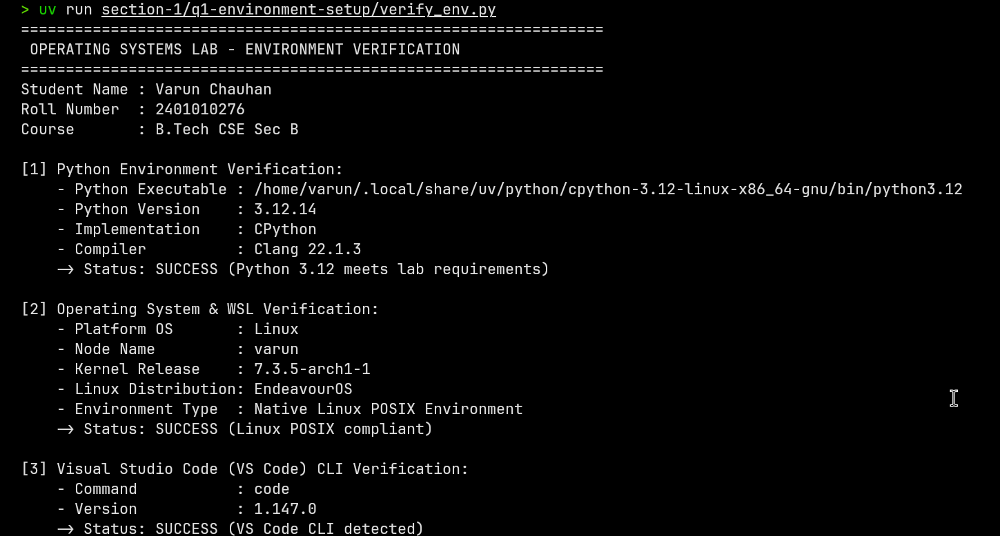

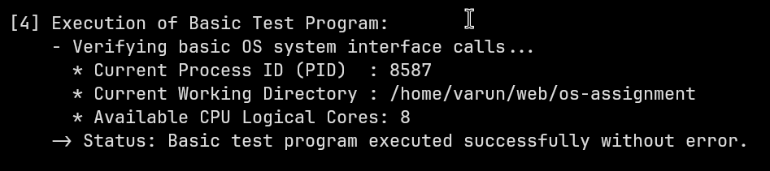


---

## Experiment 2: System Calls and Process Creation

> **Directory:** [`./section-1/q2-system-calls-processes`](./section-1/q2-system-calls-processes) | **Source Code:** [`process_syscalls.py`](./section-1/q2-system-calls-processes/process_syscalls.py)

### 1. Problem Statement & Objectives
Demonstrate fundamental OS system calls and process management:
1. **Child Process Creation**: Spawn a child process using `os.fork()`.
2. **Process Identifiers**: Display PID and Parent PID (`os.getpid()`, `os.getppid()`).
3. **Process Synchronization**: Use `os.waitpid()` to wait for child completion and inspect exit status.
4. **Command Execution**: Execute a harmless Linux command (`uname -s -r -m`) from the child.
5. **Controlled File I/O**: Open (`os.open`), write (`os.write`), read (`os.read`), and close (`os.close`) a file using POSIX descriptors.
6. **Device Interfaces**: Interact with `/dev/null`, `/dev/zero`, and `/proc/version`.
7. **Error Handling**: Gracefully catch and report errors when attempting to access invalid paths.
8. **Evidence**: Clearly display evidence for each operation.

---

### 2. Theoretical Concepts
- **`fork()` System Call**: Duplicates the calling process. The child receives an exact duplicate of the parent's address space, with a unique PID.
- **`wait()` / `waitpid()`**: Blocks the parent until the child changes state, preventing zombie processes.
- **Special Device Files**:
  - `/dev/null`: Discards all data written to it; returns EOF on read.
  - `/dev/zero`: Provides an endless stream of null bytes (`\0`).
  - `/proc`: A virtual filesystem presenting kernel and process information.

---

### 3. How to Run the Script

```bash
python3 process_syscalls.py
```

---

### 4. Output Screenshots

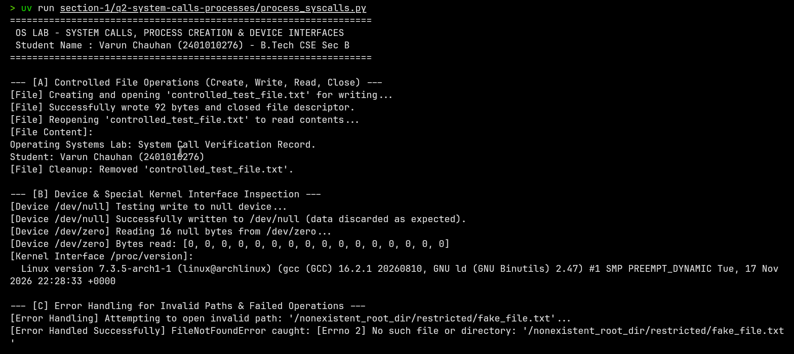

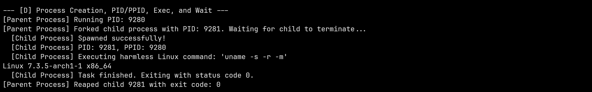


---

## Experiment 3: FCFS and SJF Scheduling

> **Directory:** [`./section-1/q3-fcfs-sjf`](./section-1/q3-fcfs-sjf) | **Source Code:** [`scheduling_fcfs_sjf.py`](./section-1/q3-fcfs-sjf/scheduling_fcfs_sjf.py)

### 1. Problem Statement & Objectives
Implement and compare CPU scheduling algorithms on a common validated dataset:
1. **Input Validation**: Check that Arrival Time $\ge 0$ and Burst Time $> 0$.
2. **Data Preservation**: Retain the original process dataset untouched across algorithms.
3. **FCFS Algorithm**: First-Come, First-Served based strictly on arrival time.
4. **Non-preemptive SJF**: Select the shortest available job from arrived processes.
5. **Tie-Breaking Rule**: Earlier arrival time, then PID order.
6. **CPU Idle Periods**: Explicitly detect and display intervals when no process is ready.
7. **Sequence & Intervals**: Print exact start/end intervals and execution sequences for both algorithms.

---

### 2. Algorithm Overview
- **FCFS**: Executes processes in FIFO order of their arrival. Simple, non-preemptive, but susceptible to the **Convoy Effect**.
- **SJF (Non-preemptive)**: At time $t$, examines all processes with $AT \le t$. Picks the one with minimum $BT$. Minimizes average waiting time.

---

### 3. How to Run the Script

Run with the standard test dataset:
```bash
python3 scheduling_fcfs_sjf.py
```

Run in interactive mode:
```bash
python3 scheduling_fcfs_sjf.py --interactive
```

---

### 4. Output Screenshots

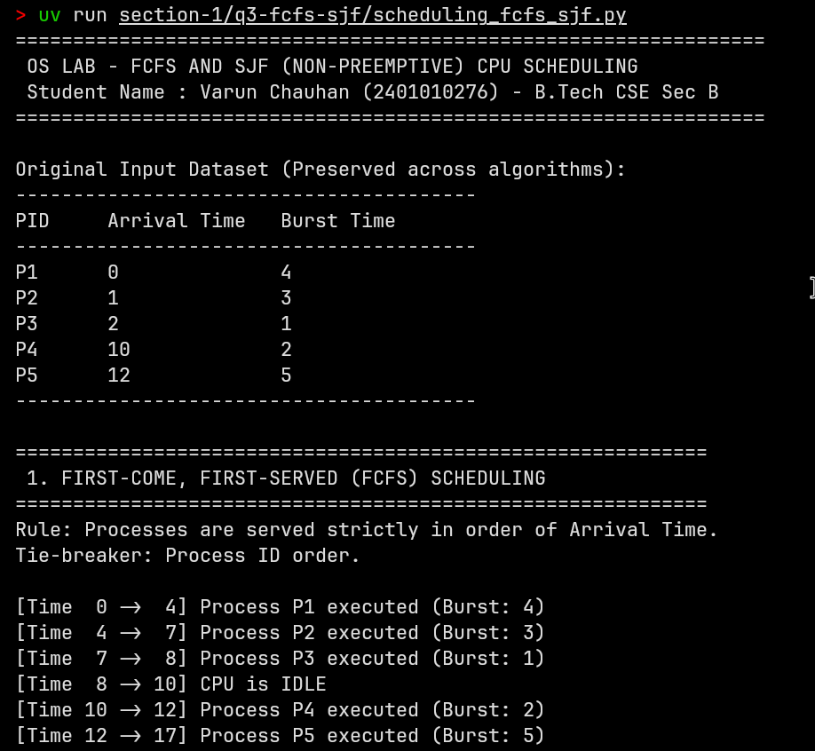

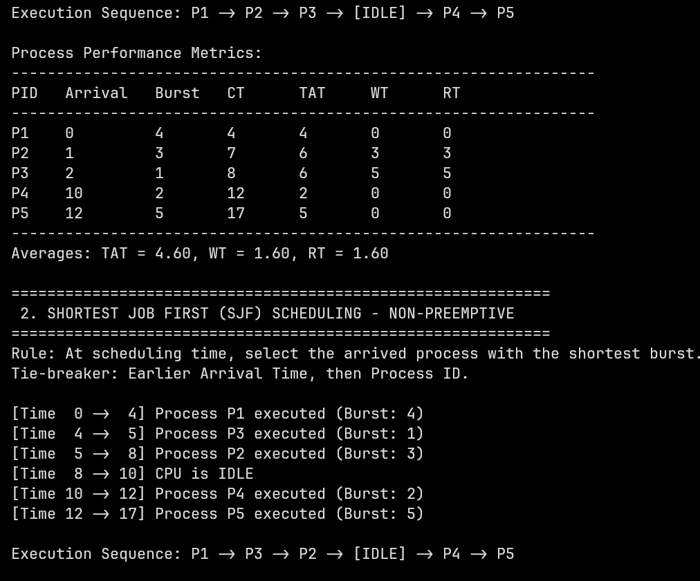

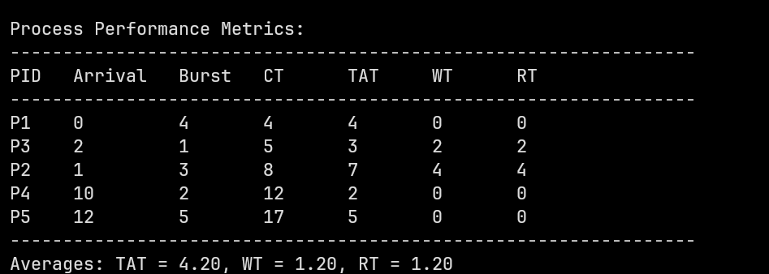


---

## Experiment 4: Priority and Round Robin Scheduling

> **Directory:** [`./section-1/q4-priority-round-robin`](./section-1/q4-priority-round-robin) | **Source Code:** [`scheduling_priority_rr.py`](./section-1/q4-priority-round-robin/scheduling_priority_rr.py)

### 1. Problem Statement & Objectives
Implement and compare Priority and Round Robin (RR) scheduling:
1. **Input Format**: Process ID, Arrival Time, Burst Time, and Priority.
2. **Priority Convention**: Clearly defined convention: **Lower numeric value indicates HIGHER priority** (e.g., Priority 1 > Priority 2).
3. **Non-preemptive Priority Scheduling**: Select the highest priority process from arrived jobs.
4. **Time Quantum**: Accept and validate a positive integer quantum (e.g., $q = 3$).
5. **FIFO Ready Queue**: Maintain a strict FIFO queue for Round Robin execution.
6. **Execution Slices**: Record and display every CPU time slice allocated to each process.
7. **Idle Time Detection**: Clearly record CPU idle periods.
8. **Summary & Metrics**: Report separate execution sequences, Completion Time, Turnaround Time, Waiting Time, and Response Time.

---

### 2. Theoretical Concepts
- **Priority Scheduling**: Allocates CPU to processes based on importance or urgency. Non-preemptive priority executes the selected process to completion before re-evaluating priorities. Can lead to starvation of low-priority processes (mitigated in practice by *aging*).
- **Round Robin (RR)**: Designed for time-sharing systems. Each process receives a fixed time slice (quantum $q$). Preempted processes return to the tail of the ready queue. Ensures responsiveness and fairness.

---

### 3. How to Run the Script

Run with standard dataset:
```bash
python3 scheduling_priority_rr.py
```

Run in interactive mode:
```bash
python3 scheduling_priority_rr.py --interactive
```

---

### 4. Output Screenshots

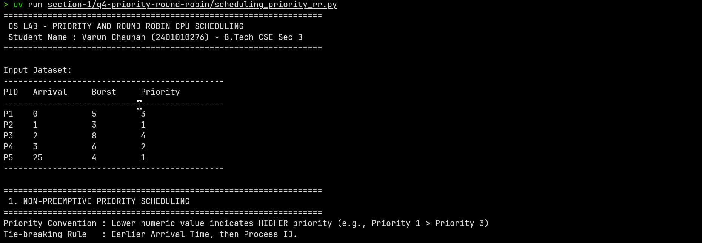

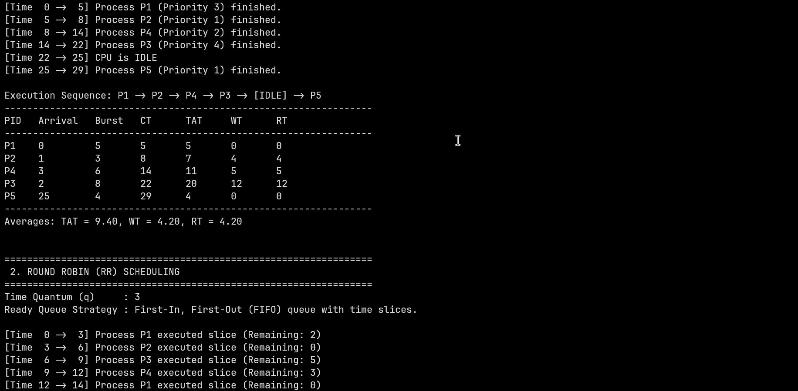

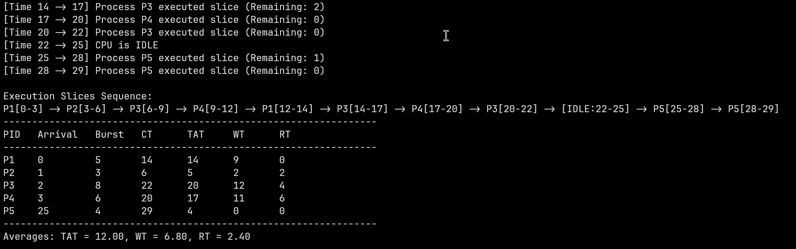


---

## Experiment 5: Scheduling Metrics, Threads and IPC

> **Directory:** [`./section-1/q5-scheduling-threads-ipc`](./section-1/q5-scheduling-threads-ipc) | **Source Code:** [`metrics_threads_ipc.py`](./section-1/q5-scheduling-threads-ipc/metrics_threads_ipc.py)

### 1. Problem Statement & Objectives
1. **Scheduling Metrics**: Calculate Completion Time ($CT$), Turnaround Time ($TAT = CT - AT$), Waiting Time ($WT = TAT - BT$), and Response Time ($RT = \text{First Exec Time} - AT$).
2. **Averages**: Compute average $TAT$, $WT$, and $RT$.
3. **Gantt Chart**: Render an ASCII Gantt chart with exact time boundaries, including Round Robin execution slices and CPU idle intervals.
4. **Multithreading**: Create multiple worker threads using Python's `threading` module, displaying thread identifiers and workload distribution.
5. **Inter-Process Communication (IPC)**: Demonstrate message exchange between distinct processes using `multiprocessing.Pipe` and `multiprocessing.Queue`.
6. **Analysis & Discussion**:
   - Compare scheduling metrics.
   - Explain benefits of threads vs processes.
   - Discuss IPC limitations.

---

### 2. Theoretical Analysis

### A. Threading Benefits vs Processes
- **Shared Memory Space**: Threads within the same process share code, data, and heap, enabling zero-copy data exchange.
- **Low Creation & Context-Switch Overhead**: Creating a thread does not duplicate page tables or file descriptors.
- **Responsiveness**: Background threads handle I/O or computations while the main thread remains responsive.

### B. IPC Mechanisms & Limitations
- **Pipes (`multiprocessing.Pipe`)**: Fast, bidirectional byte stream between two processes. Limitation: Only supports two endpoints (1-to-1).
- **Queues (`multiprocessing.Queue`)**: Thread/process-safe FIFO buffer supporting multiple producers and multiple consumers (M-to-N). Limitation: Extra serialization (pickling) overhead and kernel buffer limits.

---

### 3. How to Run the Script

```bash
python3 metrics_threads_ipc.py
```

---

### 4. Output Screenshots

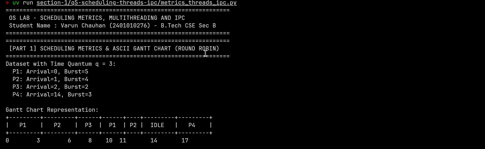

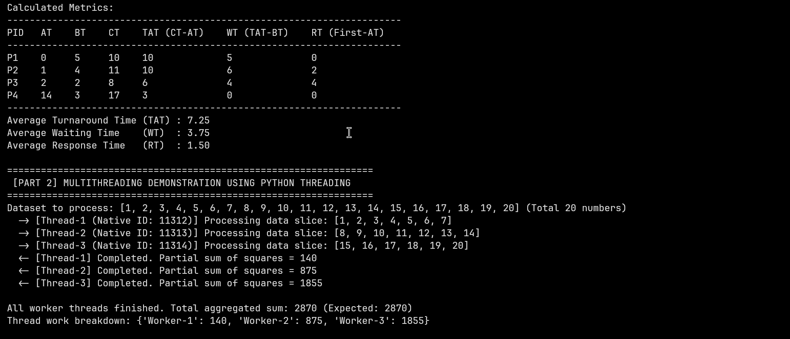

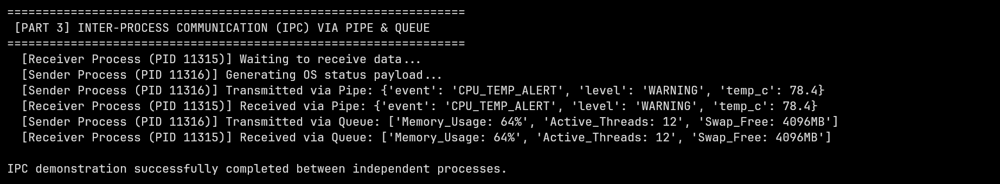


---

## Experiment 6: Thread Creation, Models and Benefits

> **Directory:** [`./section-2/q1-threads-models`](./section-2/q1-threads-models) | **Source Code:** [`threads_models.py`](./section-2/q1-threads-models/threads_models.py)

### 1. Problem Statement & Objectives
1. **Single-Threaded Baseline**: Execute a defined compute workload sequentially and measure total execution time.
2. **Workload Division**: Partition the workload into independent, non-overlapping tasks.
3. **Multithreaded Execution**: Create worker threads using Python's `threading.Thread`.
4. **Thread Information**: Print native Thread IDs (`threading.get_native_id()`), thread names, and progress updates.
5. **Thread Synchronization**: Wait for all worker threads using `.join()`.
6. **Performance Measurement**: Compare single-threaded vs multithreaded completion times.
7. **Theory & Concepts**:
   - User-level threads vs Kernel-level threads.
   - Multithreading models ($1:1$, $M:1$, $M:N$).
   - Responsiveness, resource sharing, concurrency vs parallelism, GIL (Global Interpreter Lock), race conditions, and overhead.

---

### 2. Theoretical Concepts

### A. Threading Models
- **Many-to-One ($M:1$)**: Many user-level threads mapped to a single kernel thread. Fast context switching in user space, but if one thread performs blocking I/O, all threads stall.
- **One-to-One ($1:1$)**: Each user thread maps to an operating system kernel thread (Linux pthreads). Offers true parallelism across CPU cores, but kernel thread creation incurs higher overhead.
- **Many-to-Many ($M:N$)**: Multiplexes many user-level threads to a smaller or equal number of kernel threads, balancing responsiveness and resource consumption.

### B. Concurrency vs Parallelism & Python GIL
- **Concurrency**: Managing multiple computations at the same time (interleaved execution).
- **Parallelism**: Executing multiple computations simultaneously on separate physical CPU cores.
- **CPython GIL**: Ensures only one thread executes Python bytecode at a time. While CPU-bound tasks in pure Python show limited speedup due to GIL contention, I/O-bound tasks gain immense concurrency benefits.

---

### 3. How to Run the Script

```bash
python3 threads_models.py
```

---

### 4. Output Screenshots

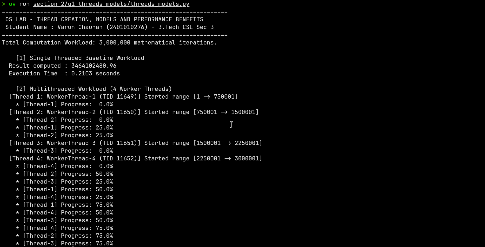

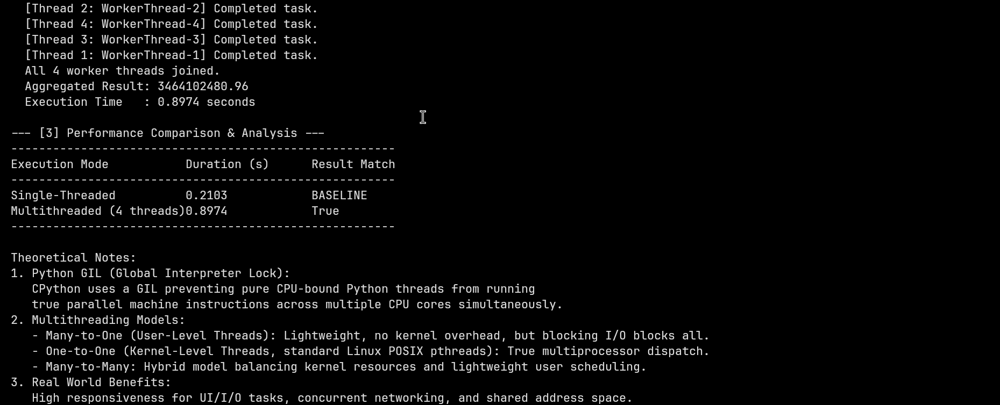


---

## Experiment 7: Race Condition, Lock and Semaphore

> **Directory:** [`./section-2/q2-race-lock-semaphore`](./section-2/q2-race-lock-semaphore) | **Source Code:** [`race_lock_semaphore.py`](./section-2/q2-race-lock-semaphore/race_lock_semaphore.py)

### 1. Problem Statement & Objectives
1. **Shared Counter**: Create a shared global variable accessible by multiple concurrent threads.
2. **Demonstrate Race Condition**: Allow threads to update the shared counter without synchronization and show lost updates.
3. **Timing-Dependent Behaviour**: Execute multiple trials to show that the corrupted result varies due to nondeterministic thread scheduling.
4. **Mutual Exclusion via Lock**: Correct the race condition using `threading.Lock`.
5. **Synchronization via Semaphore**: Implement a synchronization version using `threading.Semaphore(1)`.
6. **Performance & Overhead Comparison**: Measure and compare execution time, accuracy, and synchronization overhead across all three approaches under identical workloads.

---

### 2. Theoretical Concepts
- **Race Condition**: A situation where multiple threads access and manipulate shared data concurrently, and the outcome depends on the particular order of execution.
- **Critical Section**: A code segment accessing shared resources that must not be concurrently executed by more than one thread.
- **Mutex Lock (`threading.Lock`)**: A binary flag providing mutual exclusion. A thread calling `.acquire()` blocks if another thread holds the lock.
- **Counting / Binary Semaphore (`threading.Semaphore`)**: A generalized synchronization primitive maintaining an integer counter. A value of $1$ acts as a binary semaphore (mutex).

---

### 3. How to Run the Script

```bash
python3 race_lock_semaphore.py
```

---

### 4. Output Screenshots

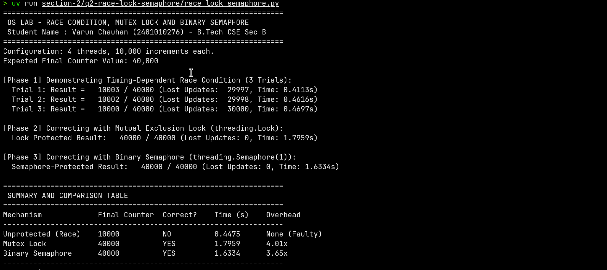


---

## Experiment 8: Classical Synchronization Problems

> **Directory:** [`./section-2/q3-classical-synchronization`](./section-2/q3-classical-synchronization) | **Source Code:** [`classical_synchronization.py`](./section-2/q3-classical-synchronization/classical_synchronization.py)

### 1. Problem Statement & Objectives
Implement the three classical synchronization problems with finite termination:
1. **Producer–Consumer Problem**:
   - Implement a finite circular buffer of capacity $N = 4$.
   - Synchronize using `empty_slots` semaphore, `full_slots` semaphore, and `mutex` lock.
2. **Readers–Writers Problem**:
   - Allow multiple readers to read concurrently.
   - Enforce exclusive writer access using `write_lock` and protected `reader_count`.
3. **Dining Philosophers Problem**:
   - Prevent circular wait deadlock using **resource ordering** (acquiring lower-indexed chopstick/fork first).
4. **Safety & Termination**:
   - Run finite iterations to ensure normal completion.
   - Display state of shared buffers, counters, and fork allocations at each step.

---

### 2. Theoretical Concepts & Deadlock Prevention

### A. Producer-Consumer (Bounded Buffer)
- Solves race conditions where producer might overwrite unconsumed items or consumer reads unwritten slots.
- `empty_slots` initialized to $N$, `full_slots` initialized to $0$.

### B. Readers-Writers (Reader Preference)
- When the first reader enters (`reader_count == 1`), it acquires `write_lock`.
- Subsequent readers increment `reader_count` without re-locking `write_lock`.
- The last exiting reader (`reader_count == 0`) releases `write_lock`.

### C. Dining Philosophers (Deadlock Prevention)
- If all philosophers pick their right fork simultaneously, a circular wait forms: $P_0 \to F_1 \to P_1 \to F_2 \to P_2 \dots \to P_0$.
- **Solution via Resource Hierarchy**: Each philosopher must acquire the lower-numbered fork before the higher-numbered fork. This breaks the circular wait condition.

---

### 3. How to Run the Script

```bash
python3 classical_synchronization.py
```

---

### 4. Output Screenshots

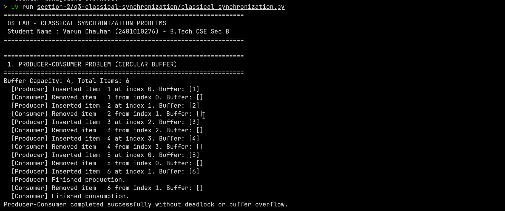

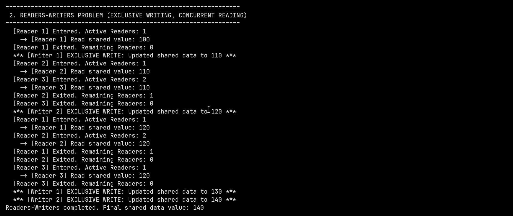

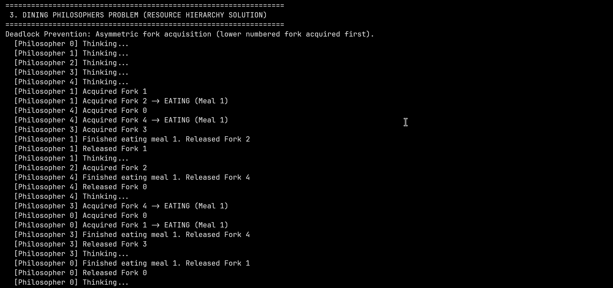

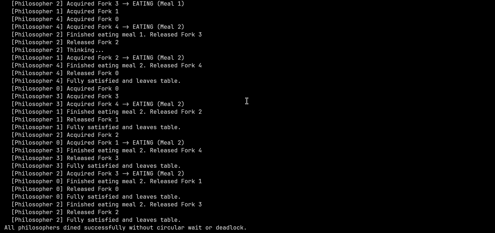


---

## Experiment 9: Deadlock Handling and Banker's Algorithm

> **Directory:** [`./section-2/q4-deadlock-bankers`](./section-2/q4-deadlock-bankers) | **Source Code:** [`deadlock_bankers.py`](./section-2/q4-deadlock-bankers/deadlock_bankers.py)

### 1. Problem Statement & Objectives
1. **Circular Wait Scenario**: Create a controlled circular-wait scenario using multithreading with timeout mechanisms to prevent permanent freezing.
2. **Coffman Conditions**: Identify the four necessary conditions:
   - Mutual Exclusion
   - Hold and Wait
   - No Preemption
   - Circular Wait
3. **Deadlock Prevention**: Demonstrate deadlock prevention by enforcing strict resource ordering.
4. **Banker's Algorithm**:
   - Accept Allocation, Maximum, and Available resource structures.
   - Compute the **Need Matrix**: $\text{Need}[i][j] = \text{Maximum}[i][j] - \text{Allocation}[i][j]$.
   - Execute the Safety Algorithm to derive a safe sequence or declare an unsafe state.
5. **Deadlock Detection & Recovery**:
   - Detect deadlocked processes using the request/allocation matrix.
   - Execute controlled recovery by terminating a selected victim process and releasing its held resources.

---

### 2. Theoretical Background
- **Banker's Algorithm (Dijkstra)**: A deadlock avoidance algorithm testing for safety by simulating the maximum possible resource allocation and verifying if a safe sequence $\langle P_1, P_2, \dots, P_n \rangle$ exists.
- **Deadlock Recovery Strategies**:
  1. *Process Termination*: Abort all deadlocked processes, or abort one at a time until the deadlock cycle is broken.
  2. *Resource Preemption*: Preempt resources from victim processes and rollback to a safe checkpoint.

---

### 3. How to Run the Script

```bash
python3 deadlock_bankers.py
```

---

### 4. Output Screenshots

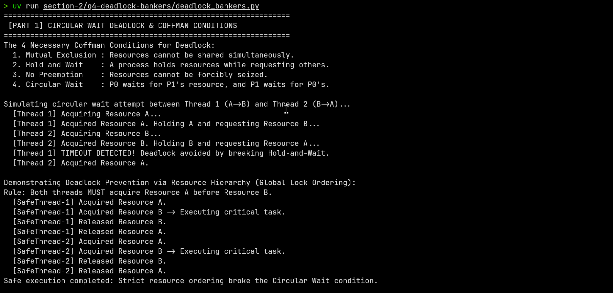

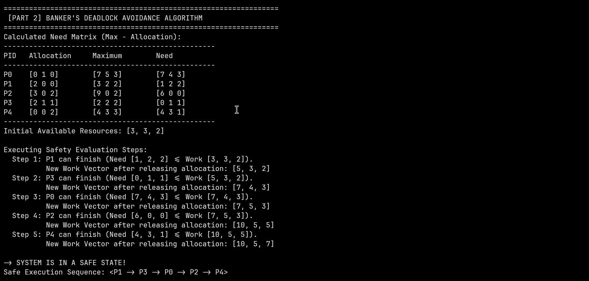

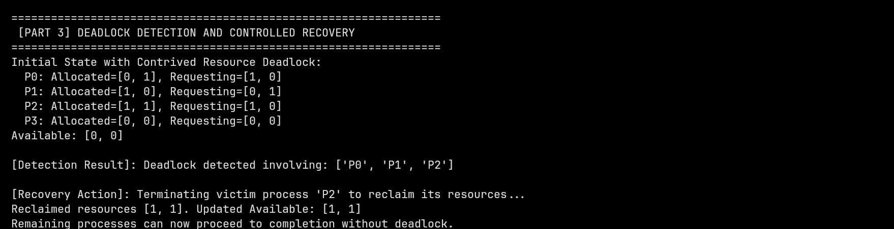


---

## Experiment 10: Contiguous Allocation, Swapping and Address Translation

> **Directory:** [`./section-3/q1-contiguous-allocation-swapping`](./section-3/q1-contiguous-allocation-swapping) | **Source Code:** [`contiguous_swapping.py`](./section-3/q1-contiguous-allocation-swapping/contiguous_swapping.py)

### 1. Problem Statement & Objectives
1. **Contiguous Allocation Algorithms**:
   - Accept memory blocks and processes (in KB).
   - Implement **First Fit** (allocates first sufficient block).
   - Implement **Best Fit** (allocates smallest sufficient block, minimizing remaining fragment).
   - Implement **Worst Fit** (allocates largest available block).
   - Use clean/fresh memory block states for each algorithm.
   - Report allocated/unallocated processes and remaining block sizes.
2. **Address Translation**:
   - Accept Base, Limit, and Logical Address values.
   - Validate logical address against limit ($0 \le \text{Logical} < \text{Limit}$).
   - Compute physical address: $\text{Physical} = \text{Base} + \text{Logical}$, or trap invalid address faults.
3. **Swapping Simulation**:
   - Simulate releasing an outgoing blocked process to secondary swap storage.
   - Load incoming high-priority process into freed memory slot.
   - Display memory state before and after swapping.

---

### 2. Theoretical Concepts
- **Internal vs External Fragmentation**:
  - *External Fragmentation*: Total free memory is sufficient to satisfy a request, but the space is not contiguous.
  - *Internal Fragmentation*: Memory allocated to a process is slightly larger than requested; unused space within the partition.
- **Relocation Register (Base)**: Loaded into CPU MMU, added to every logical address generated by the user process.
- **Limit Register**: Protects user address space; addresses $\ge \text{Limit}$ generate an addressing error trap to the OS kernel.

---

### 3. How to Run the Script

```bash
python3 contiguous_swapping.py
```

---

### 4. Output Screenshots

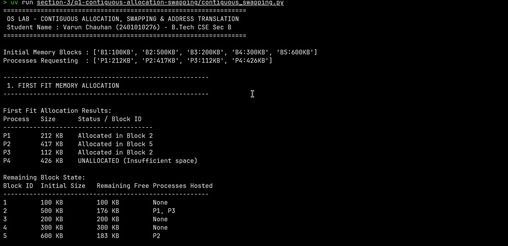

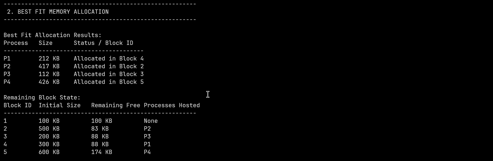

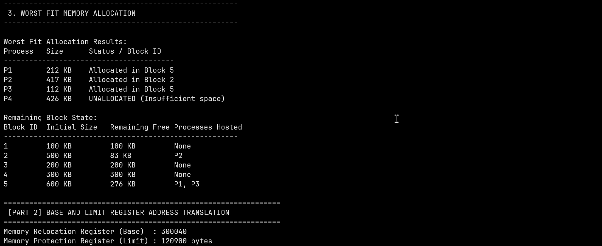

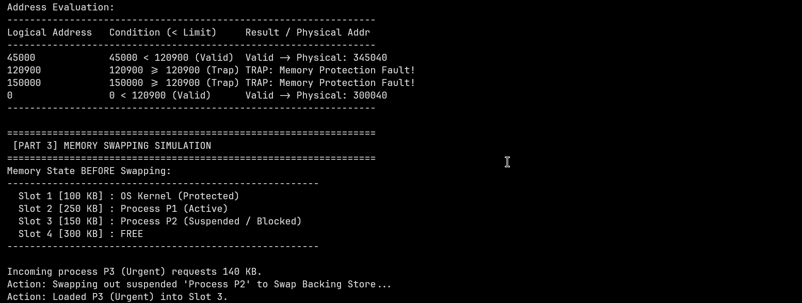

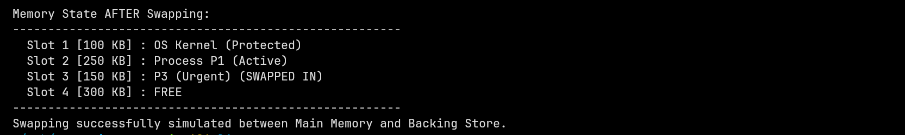


---

## Experiment 11: Paging and Segmentation

> **Directory:** [`./section-3/q2-paging-segmentation`](./section-3/q2-paging-segmentation) | **Source Code:** [`paging_segmentation.py`](./section-3/q2-paging-segmentation/paging_segmentation.py)

### 1. Problem Statement & Objectives
1. **Paging Address Translation**:
   - Accept page size (e.g., $1024$ bytes) and page table with frame numbers and valid/invalid bits.
   - For a given logical address:
     $$\text{Page Number} = \lfloor \text{Logical Address} / \text{Page Size} \rfloor$$
     $$\text{Offset} = \text{Logical Address} \pmod{\text{Page Size}}$$
   - Verify page table entry validity; reject unmapped or invalid pages (Page Fault / Trap).
   - Calculate physical address:
     $$\text{Physical Address} = (\text{Frame Number} \times \text{Page Size}) + \text{Offset}$$
2. **Segmentation Address Translation**:
   - Accept segment table with segment base and limit values.
   - For a given logical tuple $(\text{Segment \#}, \text{Offset})$:
     - Validate: Check if $\text{Offset} < \text{Limit}$.
     - If valid: $\text{Physical Address} = \text{Base} + \text{Offset}$.
     - If invalid: Trap for memory protection violation.
   - Display all intermediate calculations and decisions.

---

### 2. Theoretical Concepts
- **Paging**: Non-contiguous memory allocation technique dividing physical memory into fixed-sized blocks called **frames** and logical memory into blocks called **pages**. Eliminates external fragmentation.
- **Segmentation**: Memory-management scheme supporting the programmer's view of memory. A program is a collection of logical variable-length units (Code, Stack, Heap, Data). Subject to external fragmentation.

---

### 3. How to Run the Script

```bash
python3 paging_segmentation.py
```

---

### 4. Output Screenshots

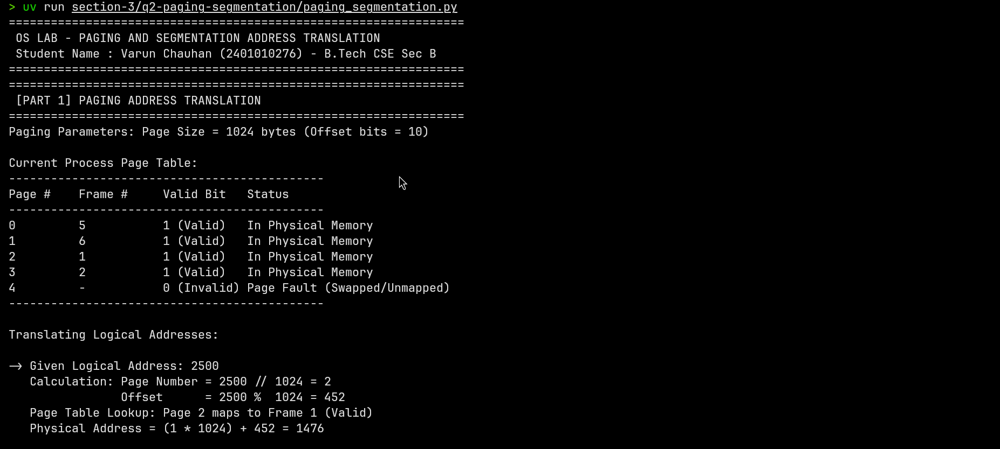

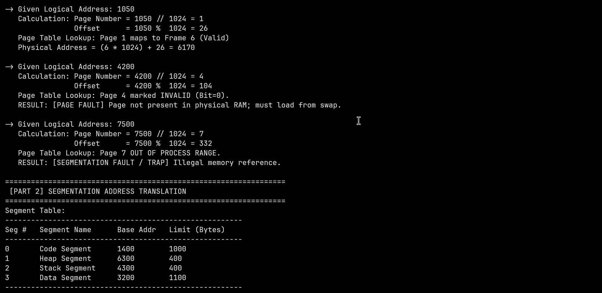

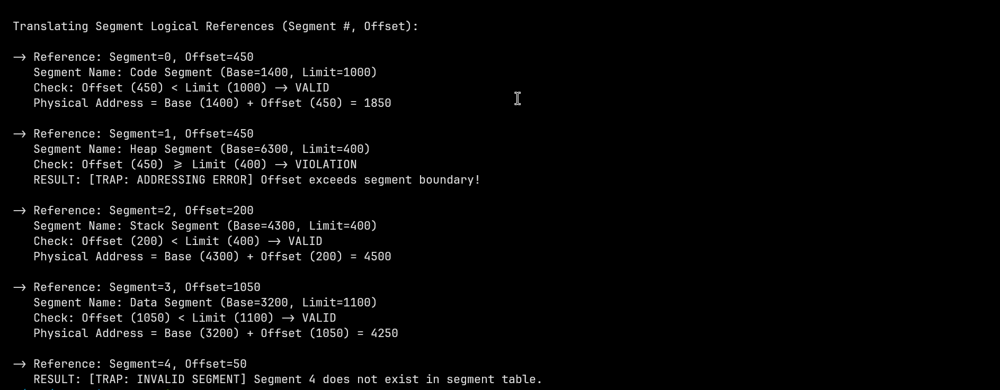


---

## Experiment 12: Demand Paging, Page Replacement and Thrashing

> **Directory:** [`./section-3/q3-demand-paging-replacement`](./section-3/q3-demand-paging-replacement) | **Source Code:** [`page_replacement.py`](./section-3/q3-demand-paging-replacement/page_replacement.py)

### 1. Problem Statement & Objectives
1. **Reference String**: Use identical reference stream: `[7, 0, 1, 2, 0, 3, 0, 4, 2, 3, 0, 3, 2, 1, 2, 0, 1, 7, 0, 1]`.
2. **Page Replacement Algorithms**:
   - **FIFO (First-In, First-Out)**: Evict oldest loaded page.
   - **LRU (Least Recently Used)**: Evict page that has not been used for the longest period of time.
   - **Optimal (Belady's Algorithm)**: Evict page that will not be used for the longest period in the future.
3. **Step-by-Step Tracing**:
   - Classify each access as **HIT** or **PAGE FAULT (MISS)**.
   - Fill free frames before replacement.
   - Print full frame buffer state after every access.
4. **Metrics**:
   - Calculate total hits, page faults, fault ratio ($Faults / Total$), and hit ratio ($Hits / Total$).
5. **Frame Allocation & Thrashing**:
   - Evaluate across multiple frame counts ($F = 2, 3, 4, 5$).
   - Identify high fault rate scenarios demonstrating **Thrashing**.

---

### 2. Theoretical Concepts & Comparisons
- **FIFO**: Simple to implement using a queue. Vulnerable to **Belady's Anomaly** (increasing frame count can sometimes increase page faults).
- **LRU**: Approximates the optimal algorithm by using past behaviour to predict the future. Does not suffer from Belady's Anomaly.
- **Optimal (OPT)**: Has the lowest possible page-fault rate for any given reference string. Serves as an unrealizable theoretical benchmark.
- **Thrashing**: Occurs when processes spend excessive time paging in/out instead of computing, caused by insufficient frame allocation.

---

### 3. How to Run the Script

```bash
python3 page_replacement.py
```

---

### 4. Output Screenshots

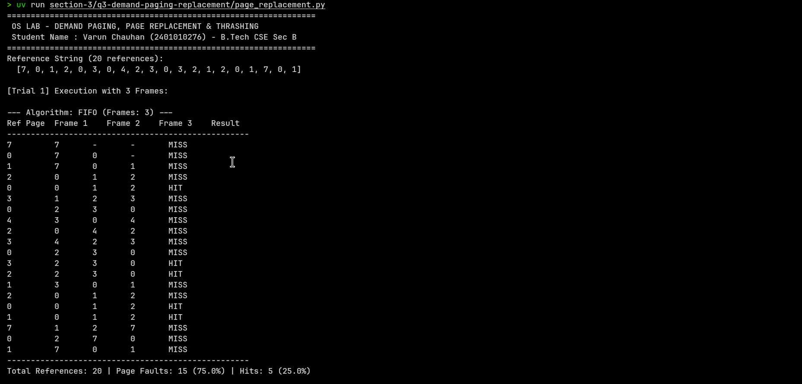

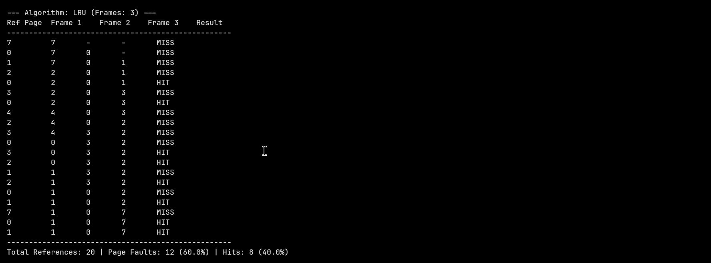

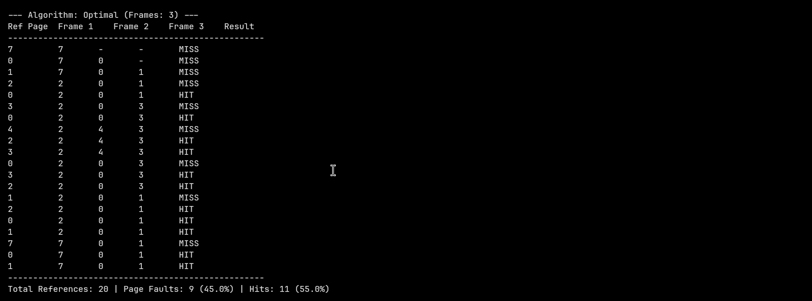

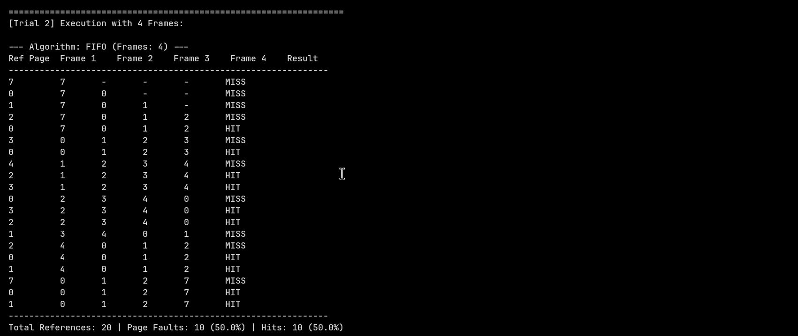

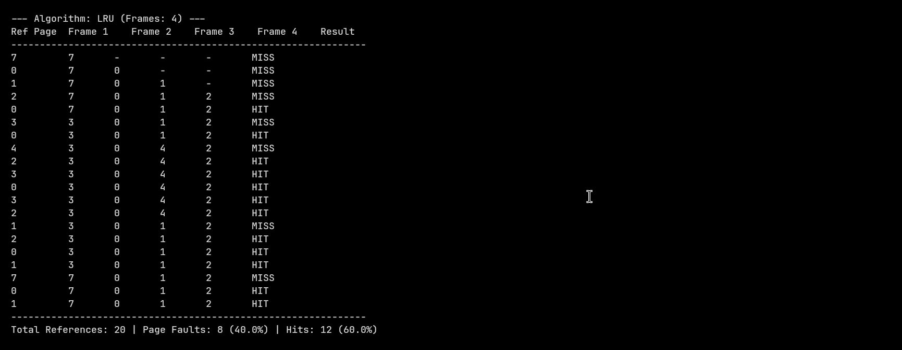

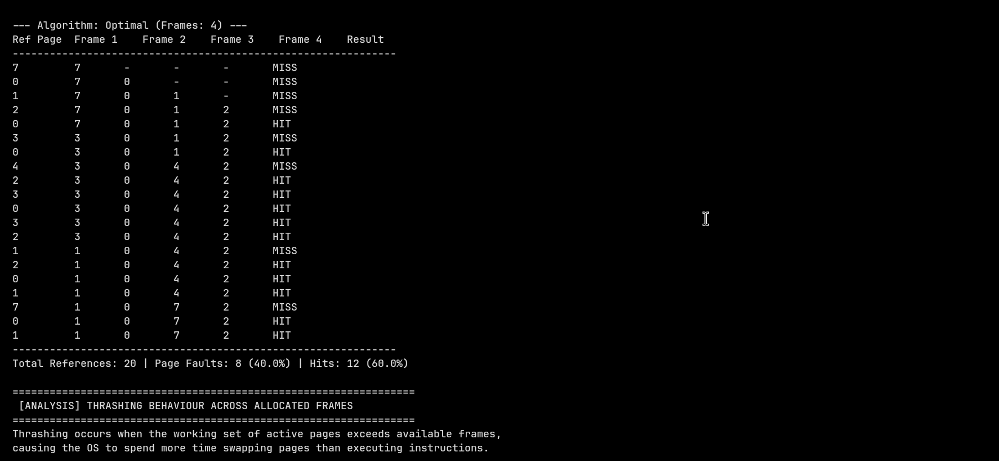

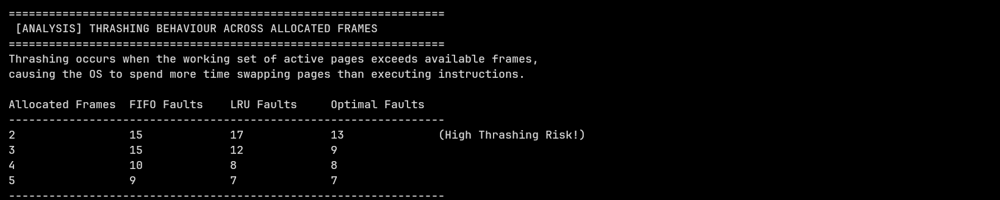


---

## Experiment 13: Device Management Simulation

> **Directory:** [`./section-3/q4-device-management`](./section-3/q4-device-management) | **Source Code:** [`device_management.py`](./section-3/q4-device-management/device_management.py)

### 1. Problem Statement & Objectives
1. **Device Record Structures**:
   - Maintain device name, device type (Dedicated, Shared, Virtual), status (`IDLE` / `BUSY`), current owner, and waiting queue.
2. **Dedicated Device Allocation**:
   - Allocate exclusive devices (e.g., dedicated hardware printer). Reject new concurrent requests and place requesting processes into a waiting queue.
3. **Shared Device Queuing**:
   - Simulate shared device access (e.g., storage disk) using an FCFS service queue policy.
4. **Virtual Device & Spooling Abstraction**:
   - Implement a software-abstracted virtual device backed by a finite buffer.
   - Trace buffer states: **Insertion**, **Removal**, **FULL**, and **EMPTY**.
5. **Device Release & Reassignment**:
   - Release device upon request completion and automatically allocate it to the next waiting process.
6. **Independence of CPU and I/O**:
   - Explain how Interrupts and Direct Memory Access (DMA) allow the CPU and I/O devices to operate concurrently and independently.

---

### 2. Theoretical Concepts
- **Dedicated Devices**: Assigned to only one process at a time until released (printers, plotters).
- **Shared Devices**: Multiple processes can interleave access (hard drives, solid state disks).
- **Virtual Devices (SPOOLing)**: *Simultaneous Peripheral Operations On-Line*. Disks act as large buffers, holding print jobs until slow output devices can accept them.
- **DMA (Direct Memory Access)**: Transfers entire blocks of data between peripheral devices and main memory without continuous CPU involvement.

---

### 3. How to Run the Script

```bash
python3 device_management.py
```

---

### 4. Output Screenshots

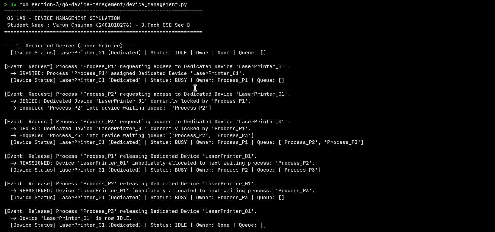

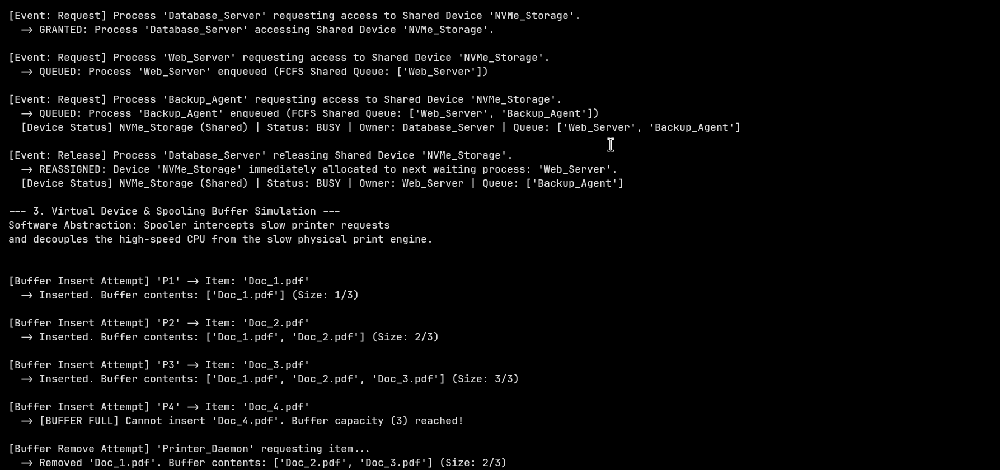

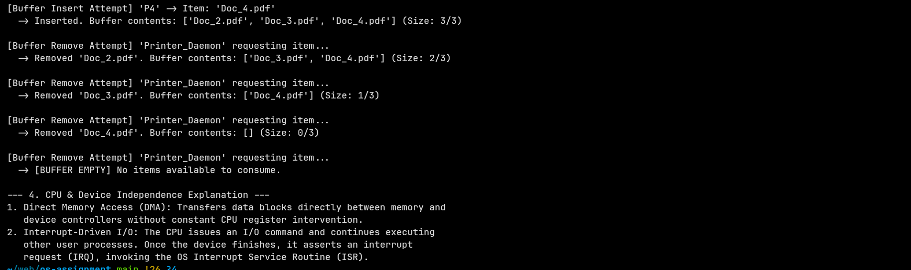


---

## Experiment 14: Disk Scheduling and Swap-Space Management

> **Directory:** [`./section-3/q5-disk-scheduling-swap`](./section-3/q5-disk-scheduling-swap) | **Source Code:** [`disk_scheduling_swap.py`](./section-3/q5-disk-scheduling-swap/disk_scheduling_swap.py)

### 1. Problem Statement & Objectives
1. **Disk Environment**:
   - Disk cylinder range: $0$ to $199$.
   - Initial read/write head position: $53$.
   - Request queue: `[98, 183, 37, 122, 14, 124, 65, 67]`.
   - Reject out-of-range requests.
2. **Scheduling Algorithms**:
   - **FCFS**: Services requests strictly in arrival order.
   - **SSTF (Shortest Seek Time First)**: Selects request with minimum seek distance from current position.
   - **SCAN (Elevator)**: Scans towards one end ($199$), servicing requests, then reverses direction.
   - **C-SCAN (Circular SCAN)**: Moves towards one end ($199$), wraps around immediately to $0$ without servicing requests on the return trip.
3. **Metrics**:
   - Print full cylinder traversal path.
   - Calculate **Total Head Movement** and **Average Head Movement**.
4. **Swap-Space Management**:
   - Create a swap bitmap block map.
   - Demonstrate dynamic allocation, rejection on insufficient space, and release of swap blocks.
5. **Comparative Analysis**: Compare fairness, head movement, and starvation vulnerability.

---

### 2. Theoretical Analysis

| Algorithm | Total Movement | Fairness | Starvation Behaviour | Notes |
| :--- | :--- | :--- | :--- | :--- |
| **FCFS** | Highest ($640$ cyl) | High (FIFO) | Zero starvation | Simple, but high mechanical seek latency. |
| **SSTF** | Low ($236$ cyl) | Poor | High risk for edge cylinders | Local optimization; prone to starvation. |
| **SCAN** | Moderate ($208$ cyl) | Good | Low | Favors cylinders near the turning point. |
| **C-SCAN** | Moderate ($382$ cyl) | Excellent | Very low | Provides uniform waiting time across cylinders. |

---

### 3. How to Run the Script

```bash
python3 disk_scheduling_swap.py
```

---

### 4. Output Screenshots

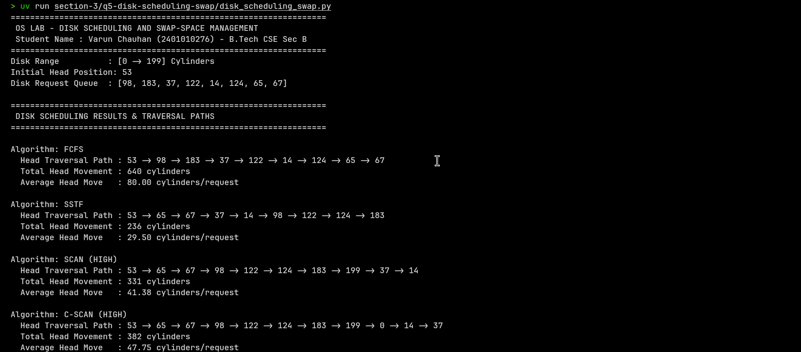

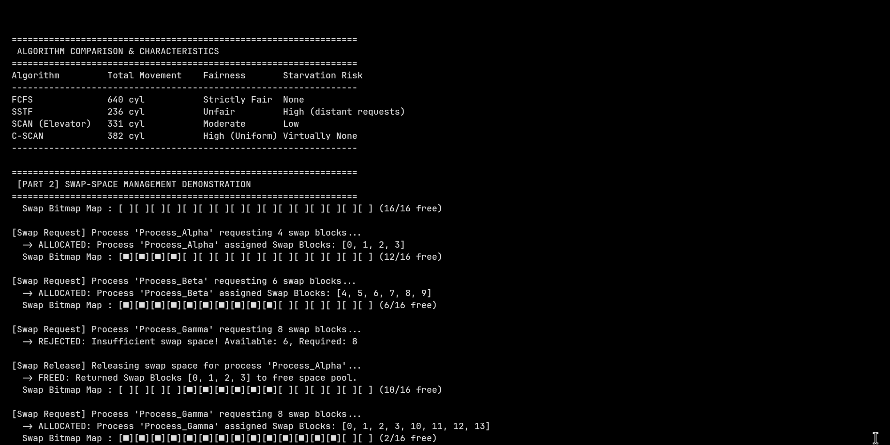


---

## Experiment 15: File Operations and Sequential Access

> **Directory:** [`./section-4/q1-file-operations-sequential`](./section-4/q1-file-operations-sequential) | **Source Code:** [`file_operations.py`](./section-4/q1-file-operations-sequential/file_operations.py)

### 1. Problem Statement & Objectives
1. **Dedicated Sandbox**: Confine all test file operations to a dedicated subdirectory (`./sandbox_fs_q1`).
2. **File Creation & Write**: Open a file for writing and store structured CSV records.
3. **Sequential Read**: Close, reopen, and sequentially read record lines one by one.
4. **Append Mode**: Append a new record (`os.O_APPEND` / `"a"` mode) without corrupting existing records.
5. **Rename & Directory Listing**: Rename file (`os.rename`) and inspect directory contents (`os.listdir`).
6. **Metadata Inspection**: Display file size, octal permissions, inode number, and timestamps via `os.stat`.
7. **Deletion & Error Handling**: Delete the file safely, verify deletion, and catch `FileNotFoundError` on invalid subsequent accesses.

---

### 2. Theoretical Concepts
- **Sequential Access**: The simplest access method; information in the file is processed in order, one record after the other (tape drives, log files).
- **File Control Block (FCB) / Inode**: Contains file metadata including permissions, ownership, size, and pointers to disk blocks.
- **File Modes**:
  - `w`: Truncates/creates for writing.
  - `r`: Opens for read-only sequential access.
  - `a`: Preserves file contents and writes data to the end.

---

### 3. How to Run the Script

```bash
python3 file_operations.py
```

---

### 4. Output Screenshots

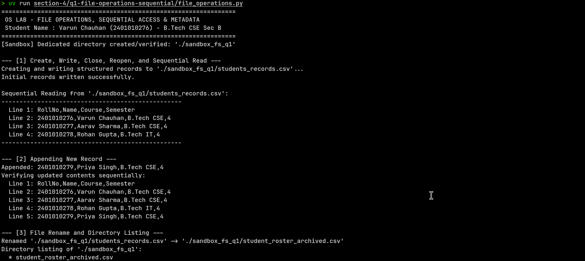

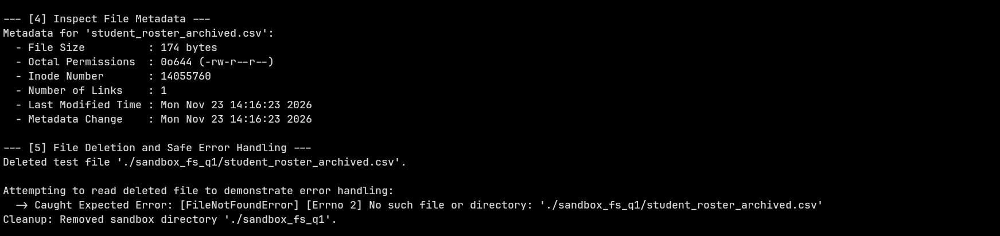


---

## Experiment 16: Direct, Indexed Access and Directory Structures

> **Directory:** [`./section-4/q2-direct-indexed-directory`](./section-4/q2-direct-indexed-directory) | **Source Code:** [`direct_indexed_directory.py`](./section-4/q2-direct-indexed-directory/direct_indexed_directory.py)

### 1. Problem Statement & Objectives
1. **Direct Access**:
   - Create a fixed-size binary record file.
   - Jump directly to target record via `seek(record_index * record_size)`.
2. **Indexed Access**:
   - Construct an in-memory index structure associating primary keys with exact byte positions.
   - Search the index before reading the target record from disk.
3. **Directory Structures**:
   - Simulate a **Single-Level Directory** (demonstrate rejection of duplicate file names).
   - Simulate a **Two-Level / Hierarchical Tree Directory Structure**.
   - Implement operations: `create`, `search`, `list`, and `delete`.
   - Render the complete parent-child directory hierarchy.

---

### 2. Theoretical Concepts
- **Direct Access (Relative Access)**: Treats the file as a numbered sequence of blocks or records. Read and write operations can occur in any arbitrary order.
- **Indexed Access**: An index is created containing pointers to various blocks. To find a record, the index is searched first, and the resulting pointer directly locates the record.
- **Directory Systems**:
  - *Single-Level*: All files in one directory; collision-prone with multiple users.
  - *Two-Level*: Separate directory for each user.
  - *Tree-Structured*: Flexible hierarchical model supporting directories within directories.

---

### 3. How to Run the Script

```bash
python3 direct_indexed_directory.py
```

---

### 4. Output Screenshots

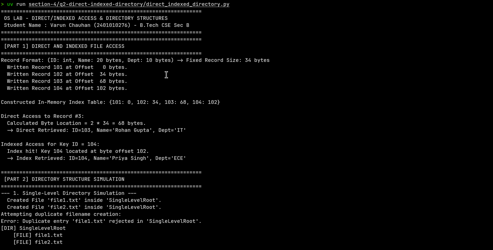

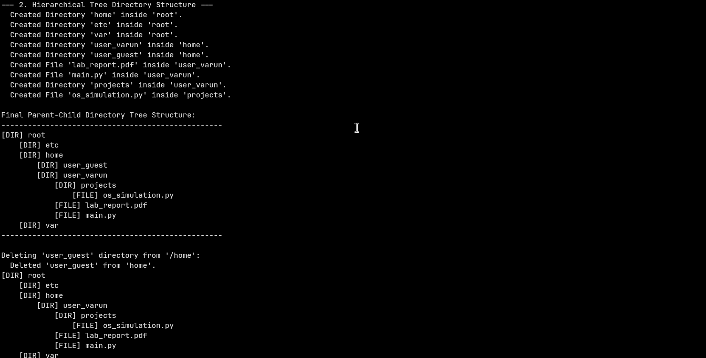


---

## Experiment 17: Contiguous, Linked and Indexed Allocation

> **Directory:** [`./section-4/q3-file-allocation-methods`](./section-4/q3-file-allocation-methods) | **Source Code:** [`file_allocation.py`](./section-4/q3-file-allocation-methods/file_allocation.py)

### 1. Problem Statement & Objectives
1. **Simulated Disk**: Model a storage disk divided into numbered logical blocks ($0$ to $31$).
2. **Contiguous Allocation**:
   - Allocate contiguous sequences of free disk blocks.
   - Record directory metadata: $\text{Start Block}$ and $\text{Length}$.
   - Reject requests when contiguous span is unavailable.
3. **Linked Allocation**:
   - Allocate scattered free blocks chained by pointers.
   - Record directory metadata: $\text{Start Block}$ and $\text{End Block}$, with each block pointing to the next ($\to \text{EOF}$).
4. **Indexed Allocation**:
   - Allocate an Index Block storing an array of pointers to data blocks.
   - Record directory metadata: $\text{Index Block Address}$.
5. **Disk Visualizations & Comparative Analysis**:
   - Display a visual disk block map.
   - Compare access speed, storage overhead, and external/internal fragmentation.

---

### 2. Theoretical Comparison

| Allocation Method | Direct Access Speed | Storage Overhead | Fragmentation |
| :--- | :--- | :--- | :--- |
| **Contiguous** | Excellent ($O(1)$) | Minimal (Start + Length) | High External Fragmentation |
| **Linked** | Poor ($O(N)$ sequential traversal) | Pointer per block ($4$ bytes) | Zero External Fragmentation |
| **Indexed** | Excellent ($O(1)$ direct lookup) | Dedicated Index Block | Zero External Fragmentation |

---

### 3. How to Run the Script

```bash
python3 file_allocation.py
```

---

### 4. Output Screenshots

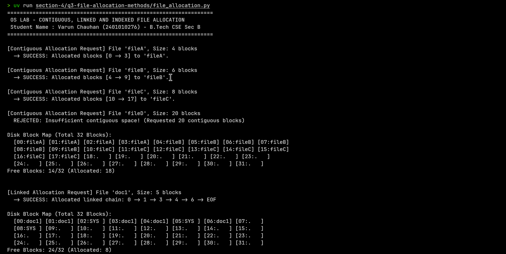

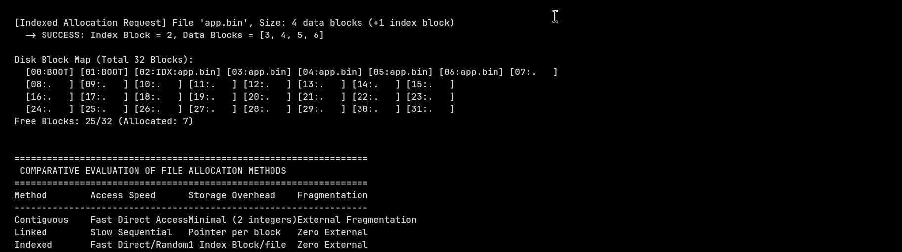


---

## Experiment 18: Free-Space Management, Deletion and Access Control

> **Directory:** [`./section-4/q4-free-space-access-control`](./section-4/q4-free-space-access-control) | **Source Code:** [`free_space_access_control.py`](./section-4/q4-free-space-access-control/free_space_access_control.py)

### 1. Problem Statement & Objectives
1. **Free-Space Management**:
   - Represent disk space using a **Bitmap** ($1 = \text{Free}, 0 = \text{Allocated}$).
   - Construct and maintain a **Free-Block List**.
   - Dynamically update free space upon file allocation.
2. **File Deletion & Block Reclamation**:
   - Release all allocated blocks back to the free pool upon file deletion.
   - Enforce an **Invariant Check**: Formally verify that no block is ever marked as simultaneously allocated and free.
3. **POSIX Access Control & Least Privilege**:
   - Inspect ownership (UID/GID), octal permissions, and symbolic modes.
   - Apply secure permissions (`0o644`, `0o400`, `0o600`) without using insecure defaults like `chmod 777`.
   - Test authorized reads vs denied writes (`PermissionError`).
   - Clean up temporary files.

---

### 2. Theoretical Concepts & Security Principles
- **Bitmap (Bit Vector)**: A compact array of bits where bit $i = 1$ indicates block $i$ is free, and bit $i = 0$ indicates block $i$ is allocated. High performance on modern CPUs with built-in bit-scan instructions.
- **Principle of Least Privilege**: A process or user should be granted only the minimum permissions necessary to accomplish its intended function.
- **Insecurity of `chmod 777`**: Grants Read, Write, and Execute rights to everyone (Owner, Group, Others), violating least privilege and exposing system resources to tampering.

---

### 3. How to Run the Script

```bash
python3 free_space_access_control.py
```

---

### 4. Output Screenshots

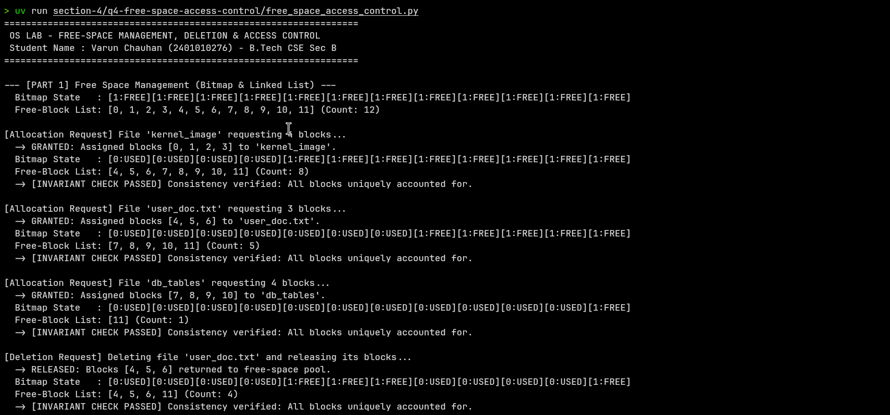


---
