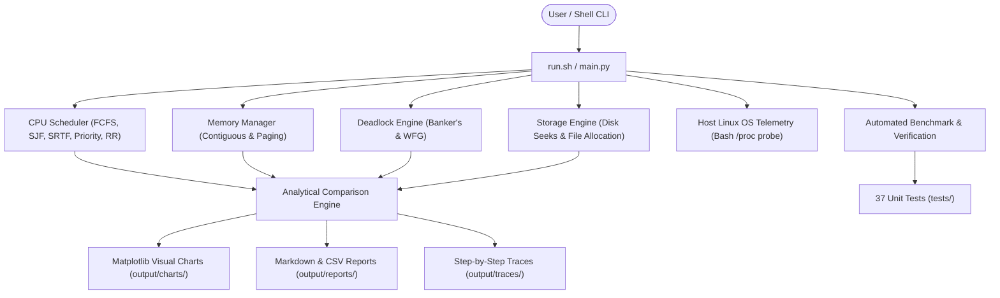
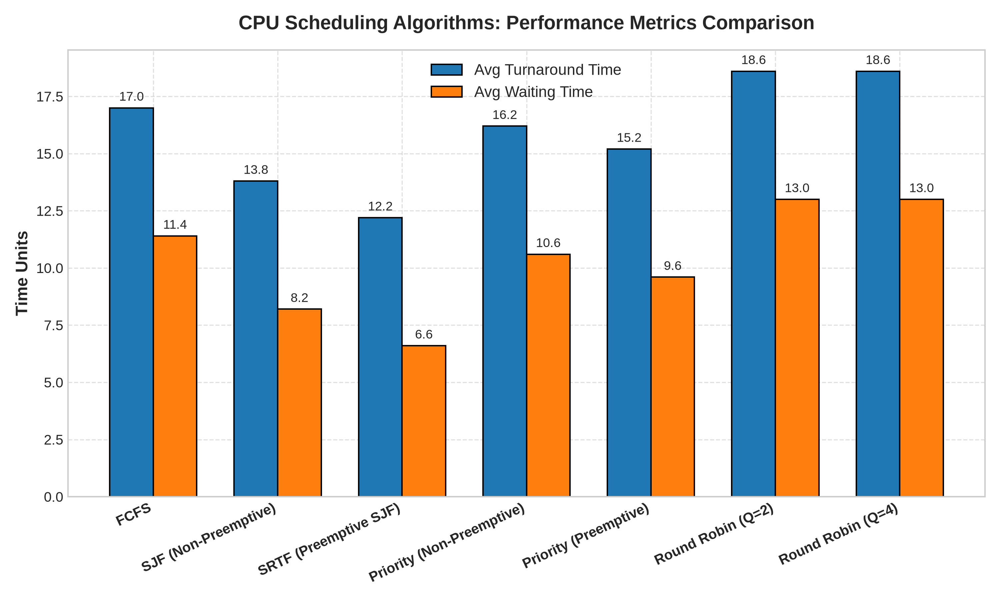
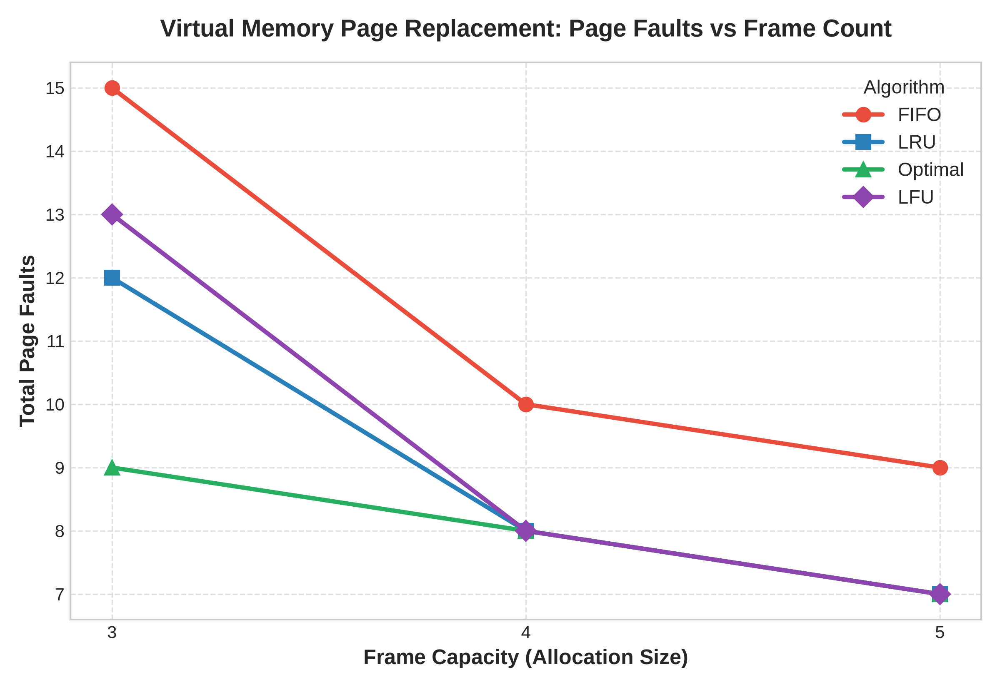
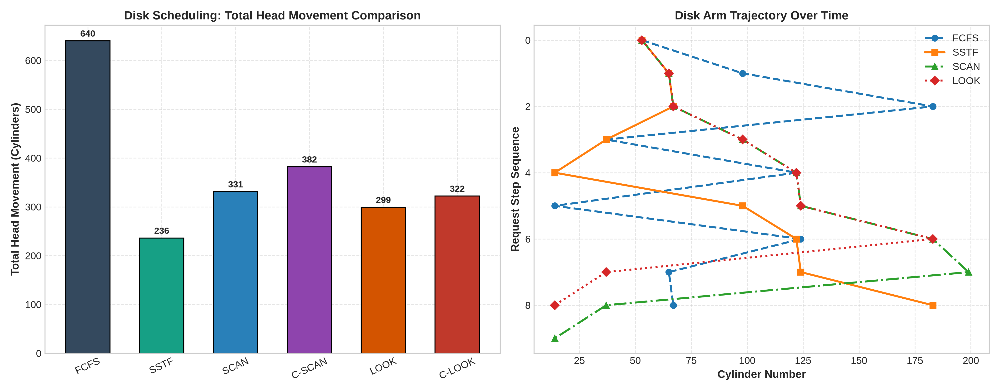
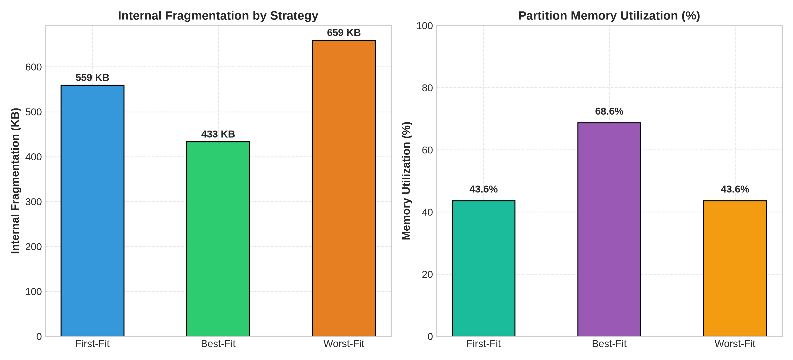

# SIM-OS: Integrated Operating System Resource Management Simulator

**Student Name:** Varun Chauhan  
**Roll Number:** 2401010276  
**Course:** B.Tech Computer Science and Engineering (Sec B)  
**Academic Subject:** Operating Systems Laboratory – Capstone Project (100 Marks)  

---

## 1. Executive Summary & Problem Statement

Modern operating systems manage critical hardware resources—CPU scheduling, primary memory partitioning, virtual memory page replacement, concurrency and deadlock prevention, and secondary storage arm movements. 

**SIM-OS** is an integrated, production-grade Python-and-Bash simulation platform designed to simulate, analyze, and benchmark major operating system resource-management subsystems. Rather than a disparate collection of scripts, SIM-OS operates as a unified, menu-driven and CLI-capable suite backed by:
- **Core Resource Simulation Engine** (Python 3)
- **Linux Kernel Host Probe & Diagnostics** (POSIX Bash `/proc` integration)
- **Automated Verification Harness & Testing Framework** (Python `unittest`)
- **Comparative Analytical Engine & Visualizer** (Matplotlib & tabular benchmarking)

---

## 2. System Architecture & Modular Design

```
capstone/
├── run.sh                          # Master Bash executable launcher (powered by uv)
├── main.py                         # Interactive TUI & CLI controller
├── pyproject.toml                  # Modern uv project configuration & dependencies
├── core/                           # Core Simulation Subsystems
│   ├── scheduler.py                # CPU Scheduling (FCFS, SJF, SRTF, Priority, RR)
│   ├── memory.py                   # Contiguous Partitioning & Page Replacement
│   ├── deadlock.py                 # Banker's Avoidance & RAG Cycle Detection
│   ├── storage.py                  # Disk Arm Scheduling & File Block Allocation
│   ├── exceptions.py               # Unified custom exception hierarchy
│   └── logger.py                   # Centralized activity & audit logging
├── bash/                           # Host OS Shell Integration
│   ├── host_telemetry.sh           # Probes Linux kernel, procfs, loadavg, meminfo
│   └── run_benchmarks.sh           # Orchestrates automated batch execution
├── analysis/                       # Analytical Benchmark & Plotting Engines
│   ├── benchmark_runner.py         # Multi-algorithm benchmark execution
│   └── visualizer.py               # Generates high-res Matplotlib charts
├── sample_inputs/                  # Standardized Workload Datasets (JSON)
│   ├── cpu_workload.json
│   ├── memory_workload.json
│   ├── deadlock_workload.json
│   └── storage_workload.json
├── tests/                          # 37-Test Verification Suite
│   ├── test_scheduler.py
│   ├── test_memory.py
│   ├── test_deadlock.py
│   ├── test_storage.py
│   └── test_integrated.py
└── output/                         # Generated Execution Artifacts
    ├── charts/                     # High-resolution comparison plots (.png)
    ├── reports/                    # Benchmark summary (.md) & CSV exports
    └── traces/                     # Verbose step-by-step execution traces (.txt)
```

### High-Level Data & Control Flow



---

## 3. Core Modules & Supported Algorithms

### Module 1: CPU Process Scheduling (`core/scheduler.py`)
- **Algorithms**: FCFS, Shortest Job First (Non-Preemptive), Shortest Remaining Time First (SRTF Preemptive), Priority (Non-Preemptive & Preemptive), Round Robin (configurable quantum).
- **Metrics Computed**: Turnaround Time ($TAT = CT - AT$), Waiting Time ($WT = TAT - BT$), Response Time ($RT = Start - AT$), CPU Utilization (%), Throughput.
- **Visual Output**: Automated ASCII Gantt chart with precise time intervals.

### Module 2: Memory Management & Virtual Memory (`core/memory.py`)
- **Contiguous Allocation**: First-Fit, Best-Fit, Worst-Fit across dynamic variable-sized memory blocks.
  - Metrics: Internal Fragmentation, External Fragmentation, Total Free Memory, Allocation Utilization %.
- **Page Replacement**: First-In-First-Out (FIFO), Least Recently Used (LRU), Optimal (Belady's MIN), Least Frequently Used (LFU).
  - Metrics: Page Faults, Hits, Hit Ratio, Fault Ratio, Step-by-Step Frame Matrix Snapshots.

### Module 3: Concurrency & Deadlock Avoidance (`core/deadlock.py`)
- **Banker's Algorithm**:
  - Safety Algorithm: Computes work vector progression and determines valid safe execution sequences.
  - Resource-Request Algorithm: Evaluates dynamic requests against current need and available pools; simulates grant and rolls back if an unsafe state would result.
- **Deadlock Detection**:
  - Wait-For Graph (WFG) cycle detection using Depth-First Search (DFS) with recursion stack tracking.

### Module 4: Storage & File Management (`core/storage.py`)
- **Disk Arm Scheduling**: FCFS, Shortest Seek Time First (SSTF), SCAN (Elevator), C-SCAN (Circular SCAN), LOOK, C-LOOK.
  - Computes: Total Head Movement (cylinders), Average Seek Length, Trajectory Sequence.
- **File System Allocation**:
  - Contiguous Allocation: Consecutive blocks, external fragmentation detection.
  - Linked Allocation: Non-contiguous pointer chains.
  - Indexed Allocation: Dedicated index block holding data block pointers.
  - Free space tracking via bit-vector (bitmap).

### Module 5: Host Linux Telemetry Integration (`bash/host_telemetry.sh`)
- Probes live Linux `/proc` filesystem:
  - Architecture, kernel release, uptime (`/proc/version`, `uptime`)
  - CPU topology, logical cores, load average (`/proc/cpuinfo`, `/proc/loadavg`)
  - RAM and Swap memory utilization (`/proc/meminfo`)
  - Process table state and top memory consumers (`ps -eo`)
  - Disk filesystem mounts and space (`df -h`)

---

## 4. Execution Guide & Commands

### Prerequisites & Dependency Management with `uv`
SIM-OS uses [**`uv`**](https://github.com/astral-sh/uv), an extremely fast Python package and project manager. All dependencies (`matplotlib`, `numpy`) are defined in `pyproject.toml`.

You don't need manual venv or pip setup; `uv` handles isolation and dependencies automatically on the fly.

### Launch Options

You can run SIM-OS using the master launcher script `./run.sh` (which auto-detects `uv`), or directly using `uv run`:

```bash
# === Master Launcher (Auto-detects uv) ===
# 1. Launch Interactive Menu
./run.sh

# 2. Run Comprehensive Automated Benchmark Suite
./run.sh --benchmark

# 3. Run Automated Unit Test Suite (37 tests)
./run.sh --test

# 4. Probe Host Linux OS Kernel Telemetry
./run.sh --telemetry

# 5. Regenerate High-Resolution Visual Plots
./run.sh --charts

# === Direct uv Commands ===
# Run interactive menu:
uv run main.py

# Run benchmark suite:
uv run python -c "from analysis.benchmark_runner import run_all_benchmarks; run_all_benchmarks()"

# Run unit tests:
uv run python -m unittest discover -s tests -p "test_*.py" -v
```

---

## 5. Analytical Results & Performance Visualizations

### 1. CPU Scheduling Comparison
Across standardized benchmark workloads ($n=5$ processes):
- **SRTF** achieved the lowest Average Waiting Time (**6.60 units**), outperforming FCFS (**11.40 units**).
- **Round Robin** balanced responsiveness across processes; $Q=2$ provides swift initial response for interactive workloads.



### 2. Virtual Memory Page Replacement Comparison
Evaluated on a 20-reference memory access string across 3, 4, and 5 frames:
- **Optimal (MIN)** achieved the minimum page fault rate (**9 faults at 3 frames, 7 faults at 5 frames**).
- **LRU** closely mirrored Optimal, significantly outperforming FIFO.



### 3. Disk Arm Scheduling Comparison
Evaluated on cylinder sequence `[98, 183, 37, 122, 14, 124, 65, 67]` with initial head position `53`:
- **SSTF** demonstrated the lowest head movement (**236 cylinders**), representing a **63.1% reduction in seek distance** compared to FCFS (**640 cylinders**).
- **LOOK** (**299 cylinders**) provided optimal arm boundary reversal without scanning unused track edges.



### 4. Memory Partitioning Allocation Comparison
Testing contiguous allocation with partitions `[100, 500, 200, 300, 600] KB`:
- **Best-Fit** successfully allocated all 4 processes with minimal internal fragmentation (**433 KB**) and **68.6% memory utilization**.
- **First-Fit** and **Worst-Fit** experienced external fragmentation, failing to allocate process `P4 (426 KB)`.



---

## 6. Testing, Verification & Reliability

The verification suite contains **37 unit tests** across all modules:
- **Valid Input Tests**: Standard workloads, multi-algorithm correct execution.
- **Boundary Conditions**: Single-process workloads, single-frame memory, head at track boundaries, zero-wait requests, complete available exhaustion.
- **Invalid Input Handling**: Custom exceptions (`InvalidProcessError`, `InvalidQuantumError`, `MemoryAllocationError`, `InvalidResourceRequestError`, `InvalidDiskRequestError`).
- **Activity Logging**: All execution events, decisions, and warnings are persisted to `logs/sim_os.log`.

Execution verification:
```
Ran 37 tests in 0.032s
OK (All passed)
```

---

## 7. Submission Artifacts

- **Detailed Academic Report**: [`REPORT.md`](REPORT.md)
- **Execution Traces**: [`output/traces/`](output/traces/)
- **Visual Comparison Plots**: [`output/charts/`](output/charts/)
- **Benchmark Summary Table**: [`output/reports/benchmark_summary.md`](output/reports/benchmark_summary.md)
- **Activity Audit Log**: [`logs/sim_os.log`](logs/sim_os.log)
