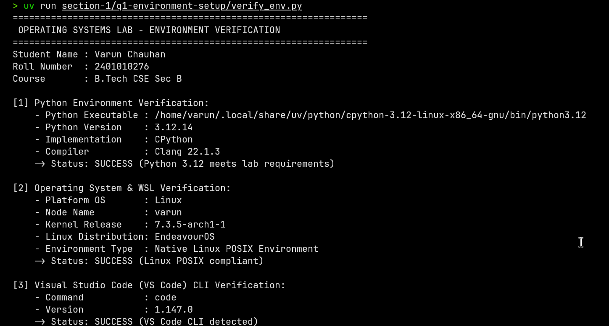
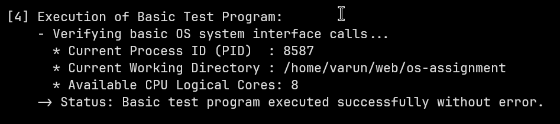

# Q1: Operating Systems Lab Environment Setup – Ubuntu, WSL, VS Code & Python

**Student Name:** Varun Chauhan  
**Roll Number:** 2401010276  
**Course:** B.Tech CSE Sec B  
**Section:** 1 (System Calls, Processes, CPU Scheduling and IPC)  

---

## 1. Problem Statement & Objectives
Set up and configure the required environment for the Operating Systems Lab.
Verify that:
1. **Ubuntu Linux**: Operating system environment for running POSIX system calls.
2. **WSL (Windows Subsystem for Linux)**: Ubuntu configuration under WSL for Windows platforms.
3. **Visual Studio Code**: Code editor with Python and WSL extensions.
4. **Python**: Python runtime (3.x) with necessary standard libraries (`os`, `sys`, `subprocess`, `platform`).
5. **Basic Test Execution**: Execute a verification script checking OS environment, version strings, CPU cores, and process ID.

---

## 2. Theoretical Background
- **POSIX API & Linux**: Linux provides standard POSIX system calls (`fork`, `exec`, `wait`, file descriptors) necessary for OS experimentation.
- **WSL Architecture**: WSL translates Linux system calls into Windows NT kernel calls (WSL1) or runs a lightweight virtualized Linux kernel (WSL2), offering native Linux execution speed and system call compatibility.
- **Python as an OS Lab Tool**: Python's standard `os`, `sys`, and `multiprocessing` modules provide direct bindings to POSIX C APIs.

---

## 3. How to Run the Script

Run the verification script from your terminal:
```bash
python3 verify_env.py
```

---

## 4. Output Screenshots




