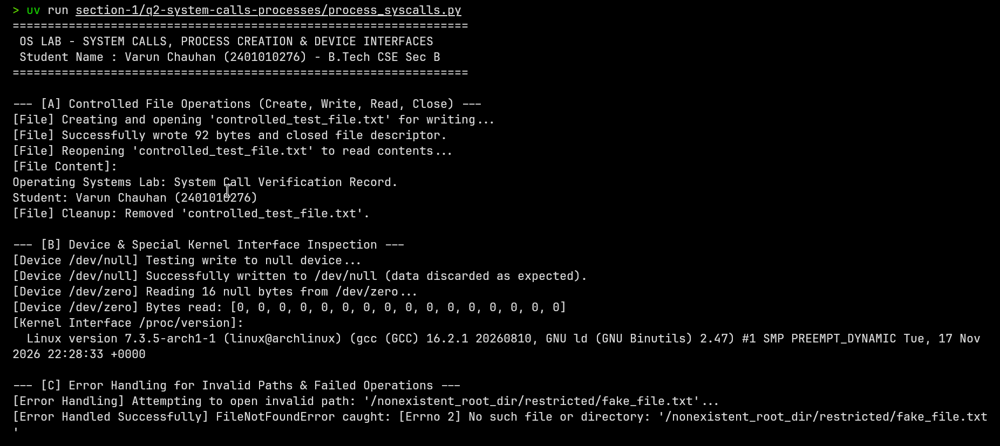
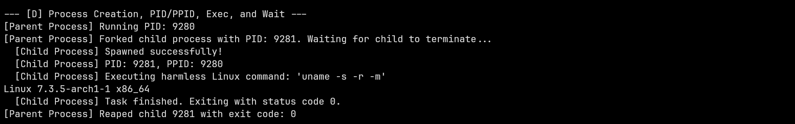

# Q2: System Calls and Process Creation

**Student Name:** Varun Chauhan  
**Roll Number:** 2401010276  
**Course:** B.Tech CSE Sec B  
**Section:** 1 (System Calls, Processes, CPU Scheduling and IPC)  

---

## 1. Problem Statement & Objectives
Demonstrate fundamental OS system calls and process management:
1. **Child Process Creation**: Spawn a child process using `os.fork()`.
2. **Process Identifiers**: Display PID and Parent PID (`os.getpid()`, `os.getppid()`).
3. **Process Synchronization**: Use `os.waitpid()` to wait for child completion and inspect exit status.
4. **Command Execution**: Execute a harmless Linux command (`uname -s -r -m`) from the child.
5. **Controlled File I/O**: Open (`os.open`), write (`os.write`), read (`os.read`), and close (`os.close`) a file using POSIX descriptors.
6. **Device Interfaces**: Interact with `/dev/null`, `/dev/zero`, and `/proc/version`.
7. **Error Handling**: Gracefully catch and report errors when attempting to access invalid paths.
8. **Evidence**: Clearly display evidence for each operation.

---

## 2. Theoretical Concepts
- **`fork()` System Call**: Duplicates the calling process. The child receives an exact duplicate of the parent's address space, with a unique PID.
- **`wait()` / `waitpid()`**: Blocks the parent until the child changes state, preventing zombie processes.
- **Special Device Files**:
  - `/dev/null`: Discards all data written to it; returns EOF on read.
  - `/dev/zero`: Provides an endless stream of null bytes (`\0`).
  - `/proc`: A virtual filesystem presenting kernel and process information.

---

## 3. How to Run the Script

```bash
python3 process_syscalls.py
```

---

## 4. Output Screenshots




