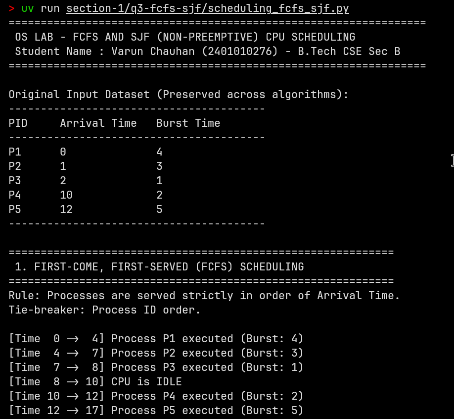
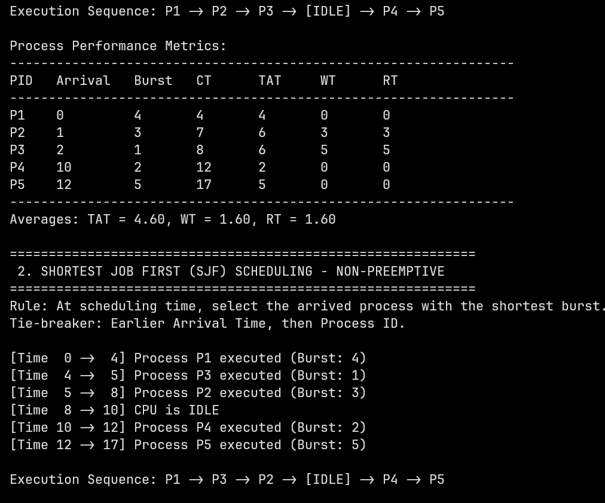
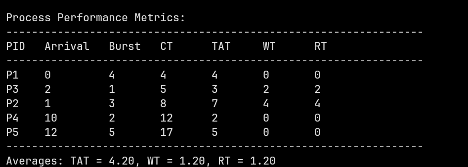

# Q3: FCFS and SJF Scheduling

**Student Name:** Varun Chauhan  
**Roll Number:** 2401010276  
**Course:** B.Tech CSE Sec B  
**Section:** 1 (System Calls, Processes, CPU Scheduling and IPC)  

---

## 1. Problem Statement & Objectives
Implement and compare CPU scheduling algorithms on a common validated dataset:
1. **Input Validation**: Check that Arrival Time $\ge 0$ and Burst Time $> 0$.
2. **Data Preservation**: Retain the original process dataset untouched across algorithms.
3. **FCFS Algorithm**: First-Come, First-Served based strictly on arrival time.
4. **Non-preemptive SJF**: Select the shortest available job from arrived processes.
5. **Tie-Breaking Rule**: Earlier arrival time, then PID order.
6. **CPU Idle Periods**: Explicitly detect and display intervals when no process is ready.
7. **Sequence & Intervals**: Print exact start/end intervals and execution sequences for both algorithms.

---

## 2. Algorithm Overview
- **FCFS**: Executes processes in FIFO order of their arrival. Simple, non-preemptive, but susceptible to the **Convoy Effect**.
- **SJF (Non-preemptive)**: At time $t$, examines all processes with $AT \le t$. Picks the one with minimum $BT$. Minimizes average waiting time.

---

## 3. How to Run the Script

Run with the standard test dataset:
```bash
python3 scheduling_fcfs_sjf.py
```

Run in interactive mode:
```bash
python3 scheduling_fcfs_sjf.py --interactive
```

---

## 4. Output Screenshots






