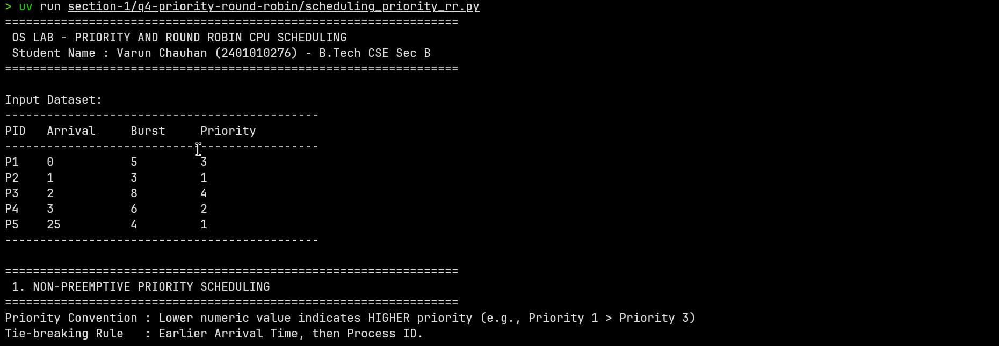
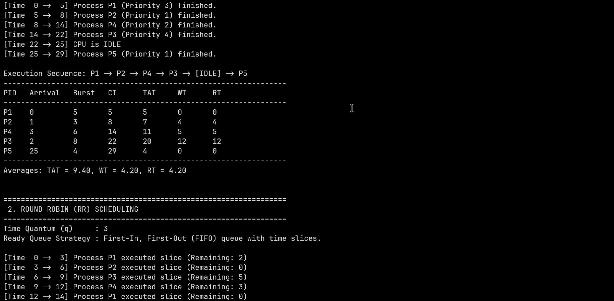
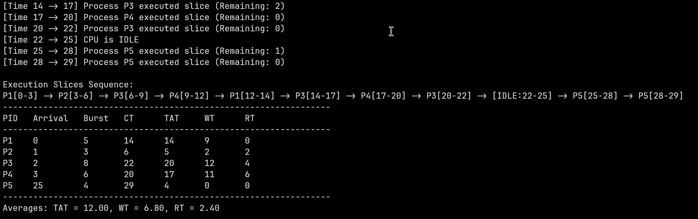

# Q4: Priority and Round Robin Scheduling

**Student Name:** Varun Chauhan  
**Roll Number:** 2401010276  
**Course:** B.Tech CSE Sec B  
**Section:** 1 (System Calls, Processes, CPU Scheduling and IPC)  

---

## 1. Problem Statement & Objectives
Implement and compare Priority and Round Robin (RR) scheduling:
1. **Input Format**: Process ID, Arrival Time, Burst Time, and Priority.
2. **Priority Convention**: Clearly defined convention: **Lower numeric value indicates HIGHER priority** (e.g., Priority 1 > Priority 2).
3. **Non-preemptive Priority Scheduling**: Select the highest priority process from arrived jobs.
4. **Time Quantum**: Accept and validate a positive integer quantum (e.g., $q = 3$).
5. **FIFO Ready Queue**: Maintain a strict FIFO queue for Round Robin execution.
6. **Execution Slices**: Record and display every CPU time slice allocated to each process.
7. **Idle Time Detection**: Clearly record CPU idle periods.
8. **Summary & Metrics**: Report separate execution sequences, Completion Time, Turnaround Time, Waiting Time, and Response Time.

---

## 2. Theoretical Concepts
- **Priority Scheduling**: Allocates CPU to processes based on importance or urgency. Non-preemptive priority executes the selected process to completion before re-evaluating priorities. Can lead to starvation of low-priority processes (mitigated in practice by *aging*).
- **Round Robin (RR)**: Designed for time-sharing systems. Each process receives a fixed time slice (quantum $q$). Preempted processes return to the tail of the ready queue. Ensures responsiveness and fairness.

---

## 3. How to Run the Script

Run with standard dataset:
```bash
python3 scheduling_priority_rr.py
```

Run in interactive mode:
```bash
python3 scheduling_priority_rr.py --interactive
```

---

## 4. Output Screenshots






