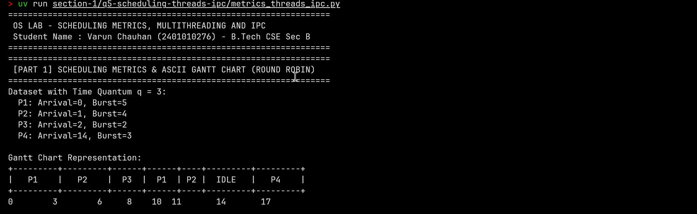
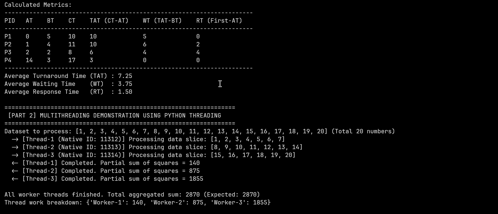
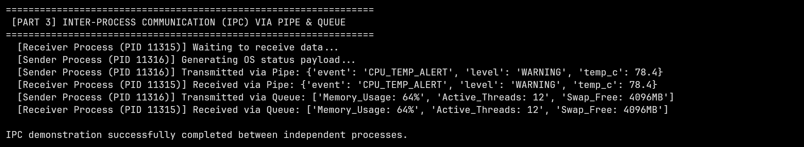

# Q5: Scheduling Metrics, Threads and IPC

**Student Name:** Varun Chauhan  
**Roll Number:** 2401010276  
**Course:** B.Tech CSE Sec B  
**Section:** 1 (System Calls, Processes, CPU Scheduling and IPC)  

---

## 1. Problem Statement & Objectives
1. **Scheduling Metrics**: Calculate Completion Time ($CT$), Turnaround Time ($TAT = CT - AT$), Waiting Time ($WT = TAT - BT$), and Response Time ($RT = \text{First Exec Time} - AT$).
2. **Averages**: Compute average $TAT$, $WT$, and $RT$.
3. **Gantt Chart**: Render an ASCII Gantt chart with exact time boundaries, including Round Robin execution slices and CPU idle intervals.
4. **Multithreading**: Create multiple worker threads using Python's `threading` module, displaying thread identifiers and workload distribution.
5. **Inter-Process Communication (IPC)**: Demonstrate message exchange between distinct processes using `multiprocessing.Pipe` and `multiprocessing.Queue`.
6. **Analysis & Discussion**:
   - Compare scheduling metrics.
   - Explain benefits of threads vs processes.
   - Discuss IPC limitations.

---

## 2. Theoretical Analysis

### A. Threading Benefits vs Processes
- **Shared Memory Space**: Threads within the same process share code, data, and heap, enabling zero-copy data exchange.
- **Low Creation & Context-Switch Overhead**: Creating a thread does not duplicate page tables or file descriptors.
- **Responsiveness**: Background threads handle I/O or computations while the main thread remains responsive.

### B. IPC Mechanisms & Limitations
- **Pipes (`multiprocessing.Pipe`)**: Fast, bidirectional byte stream between two processes. Limitation: Only supports two endpoints (1-to-1).
- **Queues (`multiprocessing.Queue`)**: Thread/process-safe FIFO buffer supporting multiple producers and multiple consumers (M-to-N). Limitation: Extra serialization (pickling) overhead and kernel buffer limits.

---

## 3. How to Run the Script

```bash
python3 metrics_threads_ipc.py
```

---

## 4. Output Screenshots






