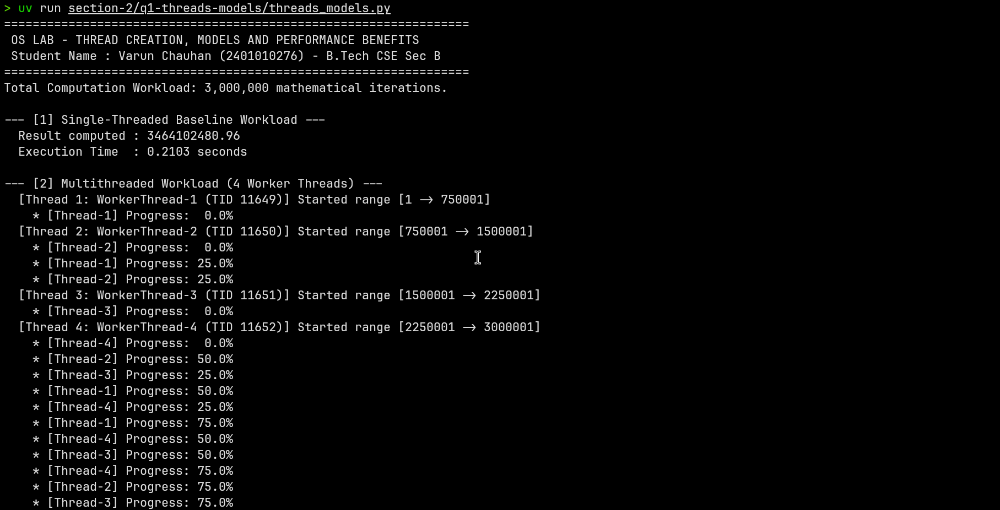
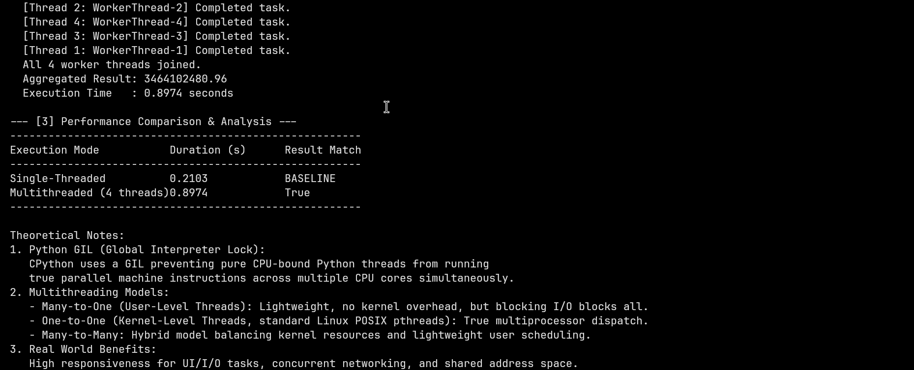

# Q1: Thread Creation, Models and Benefits

**Student Name:** Varun Chauhan  
**Roll Number:** 2401010276  
**Course:** B.Tech CSE Sec B  
**Section:** 2 (Multithreading, Synchronization and Deadlock)  

---

## 1. Problem Statement & Objectives
1. **Single-Threaded Baseline**: Execute a defined compute workload sequentially and measure total execution time.
2. **Workload Division**: Partition the workload into independent, non-overlapping tasks.
3. **Multithreaded Execution**: Create worker threads using Python's `threading.Thread`.
4. **Thread Information**: Print native Thread IDs (`threading.get_native_id()`), thread names, and progress updates.
5. **Thread Synchronization**: Wait for all worker threads using `.join()`.
6. **Performance Measurement**: Compare single-threaded vs multithreaded completion times.
7. **Theory & Concepts**:
   - User-level threads vs Kernel-level threads.
   - Multithreading models ($1:1$, $M:1$, $M:N$).
   - Responsiveness, resource sharing, concurrency vs parallelism, GIL (Global Interpreter Lock), race conditions, and overhead.

---

## 2. Theoretical Concepts

### A. Threading Models
- **Many-to-One ($M:1$)**: Many user-level threads mapped to a single kernel thread. Fast context switching in user space, but if one thread performs blocking I/O, all threads stall.
- **One-to-One ($1:1$)**: Each user thread maps to an operating system kernel thread (Linux pthreads). Offers true parallelism across CPU cores, but kernel thread creation incurs higher overhead.
- **Many-to-Many ($M:N$)**: Multiplexes many user-level threads to a smaller or equal number of kernel threads, balancing responsiveness and resource consumption.

### B. Concurrency vs Parallelism & Python GIL
- **Concurrency**: Managing multiple computations at the same time (interleaved execution).
- **Parallelism**: Executing multiple computations simultaneously on separate physical CPU cores.
- **CPython GIL**: Ensures only one thread executes Python bytecode at a time. While CPU-bound tasks in pure Python show limited speedup due to GIL contention, I/O-bound tasks gain immense concurrency benefits.

---

## 3. How to Run the Script

```bash
python3 threads_models.py
```

---

## 4. Output Screenshots




