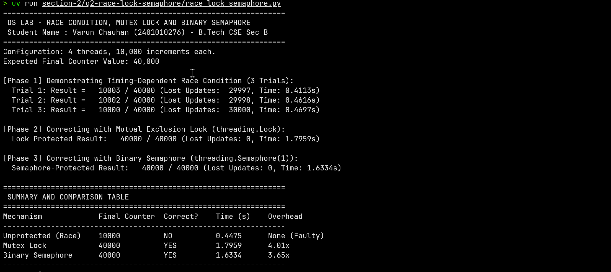

# Q2: Race Condition, Lock and Semaphore

**Student Name:** Varun Chauhan  
**Roll Number:** 2401010276  
**Course:** B.Tech CSE Sec B  
**Section:** 2 (Multithreading, Synchronization and Deadlock)  

---

## 1. Problem Statement & Objectives
1. **Shared Counter**: Create a shared global variable accessible by multiple concurrent threads.
2. **Demonstrate Race Condition**: Allow threads to update the shared counter without synchronization and show lost updates.
3. **Timing-Dependent Behaviour**: Execute multiple trials to show that the corrupted result varies due to nondeterministic thread scheduling.
4. **Mutual Exclusion via Lock**: Correct the race condition using `threading.Lock`.
5. **Synchronization via Semaphore**: Implement a synchronization version using `threading.Semaphore(1)`.
6. **Performance & Overhead Comparison**: Measure and compare execution time, accuracy, and synchronization overhead across all three approaches under identical workloads.

---

## 2. Theoretical Concepts
- **Race Condition**: A situation where multiple threads access and manipulate shared data concurrently, and the outcome depends on the particular order of execution.
- **Critical Section**: A code segment accessing shared resources that must not be concurrently executed by more than one thread.
- **Mutex Lock (`threading.Lock`)**: A binary flag providing mutual exclusion. A thread calling `.acquire()` blocks if another thread holds the lock.
- **Counting / Binary Semaphore (`threading.Semaphore`)**: A generalized synchronization primitive maintaining an integer counter. A value of $1$ acts as a binary semaphore (mutex).

---

## 3. How to Run the Script

```bash
python3 race_lock_semaphore.py
```

---

## 4. Output Screenshots


