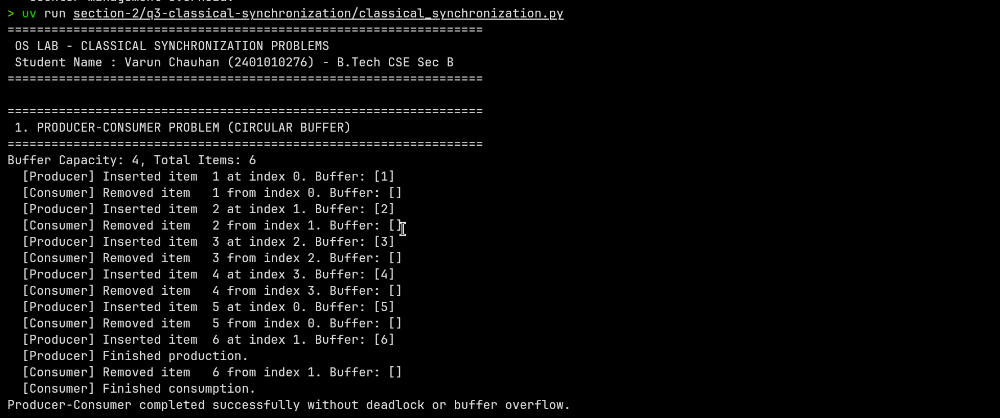
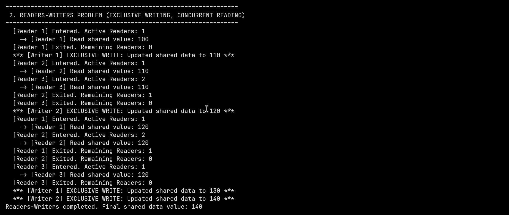
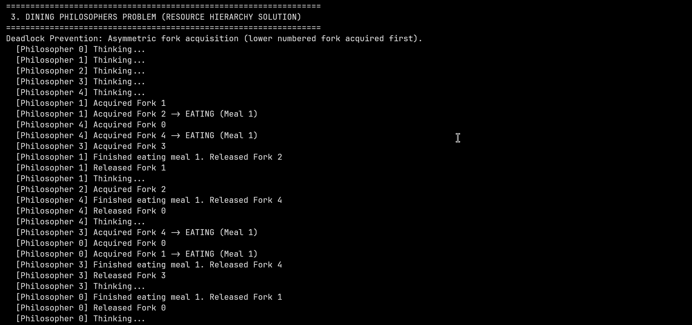
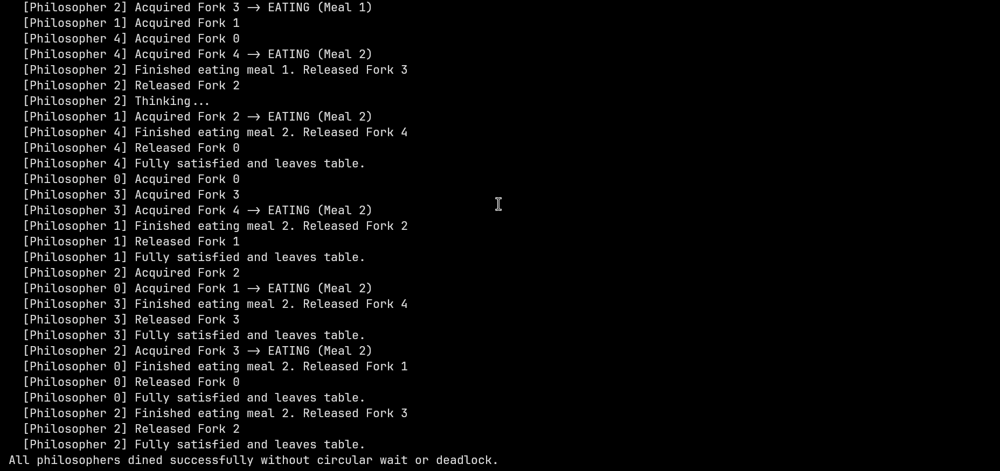

# Q3: Classical Synchronization Problems

**Student Name:** Varun Chauhan  
**Roll Number:** 2401010276  
**Course:** B.Tech CSE Sec B  
**Section:** 2 (Multithreading, Synchronization and Deadlock)  

---

## 1. Problem Statement & Objectives
Implement the three classical synchronization problems with finite termination:
1. **Producer–Consumer Problem**:
   - Implement a finite circular buffer of capacity $N = 4$.
   - Synchronize using `empty_slots` semaphore, `full_slots` semaphore, and `mutex` lock.
2. **Readers–Writers Problem**:
   - Allow multiple readers to read concurrently.
   - Enforce exclusive writer access using `write_lock` and protected `reader_count`.
3. **Dining Philosophers Problem**:
   - Prevent circular wait deadlock using **resource ordering** (acquiring lower-indexed chopstick/fork first).
4. **Safety & Termination**:
   - Run finite iterations to ensure normal completion.
   - Display state of shared buffers, counters, and fork allocations at each step.

---

## 2. Theoretical Concepts & Deadlock Prevention

### A. Producer-Consumer (Bounded Buffer)
- Solves race conditions where producer might overwrite unconsumed items or consumer reads unwritten slots.
- `empty_slots` initialized to $N$, `full_slots` initialized to $0$.

### B. Readers-Writers (Reader Preference)
- When the first reader enters (`reader_count == 1`), it acquires `write_lock`.
- Subsequent readers increment `reader_count` without re-locking `write_lock`.
- The last exiting reader (`reader_count == 0`) releases `write_lock`.

### C. Dining Philosophers (Deadlock Prevention)
- If all philosophers pick their right fork simultaneously, a circular wait forms: $P_0 \to F_1 \to P_1 \to F_2 \to P_2 \dots \to P_0$.
- **Solution via Resource Hierarchy**: Each philosopher must acquire the lower-numbered fork before the higher-numbered fork. This breaks the circular wait condition.

---

## 3. How to Run the Script

```bash
python3 classical_synchronization.py
```

---

## 4. Output Screenshots








