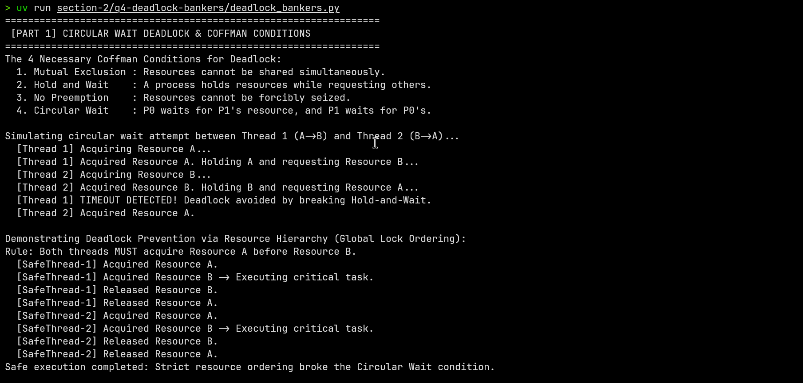
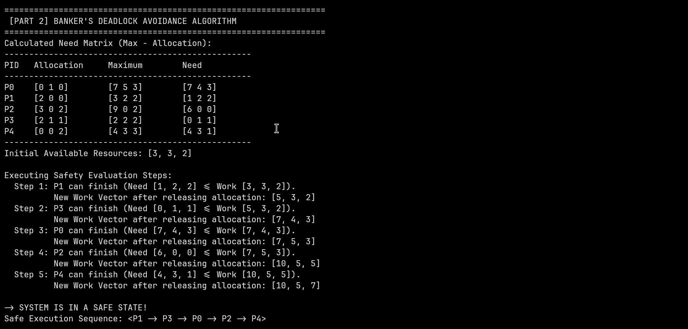
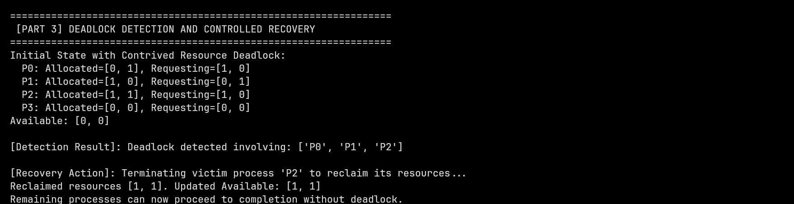

# Q4: Deadlock Handling and Banker's Algorithm

**Student Name:** Varun Chauhan  
**Roll Number:** 2401010276  
**Course:** B.Tech CSE Sec B  
**Section:** 2 (Multithreading, Synchronization and Deadlock)  

---

## 1. Problem Statement & Objectives
1. **Circular Wait Scenario**: Create a controlled circular-wait scenario using multithreading with timeout mechanisms to prevent permanent freezing.
2. **Coffman Conditions**: Identify the four necessary conditions:
   - Mutual Exclusion
   - Hold and Wait
   - No Preemption
   - Circular Wait
3. **Deadlock Prevention**: Demonstrate deadlock prevention by enforcing strict resource ordering.
4. **Banker's Algorithm**:
   - Accept Allocation, Maximum, and Available resource structures.
   - Compute the **Need Matrix**: $\text{Need}[i][j] = \text{Maximum}[i][j] - \text{Allocation}[i][j]$.
   - Execute the Safety Algorithm to derive a safe sequence or declare an unsafe state.
5. **Deadlock Detection & Recovery**:
   - Detect deadlocked processes using the request/allocation matrix.
   - Execute controlled recovery by terminating a selected victim process and releasing its held resources.

---

## 2. Theoretical Background
- **Banker's Algorithm (Dijkstra)**: A deadlock avoidance algorithm testing for safety by simulating the maximum possible resource allocation and verifying if a safe sequence $\langle P_1, P_2, \dots, P_n \rangle$ exists.
- **Deadlock Recovery Strategies**:
  1. *Process Termination*: Abort all deadlocked processes, or abort one at a time until the deadlock cycle is broken.
  2. *Resource Preemption*: Preempt resources from victim processes and rollback to a safe checkpoint.

---

## 3. How to Run the Script

```bash
python3 deadlock_bankers.py
```

---

## 4. Output Screenshots






