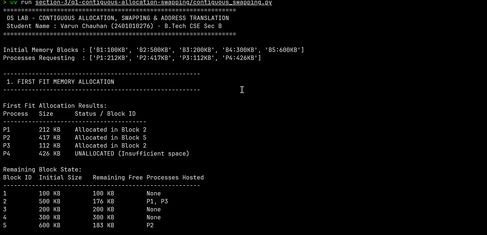
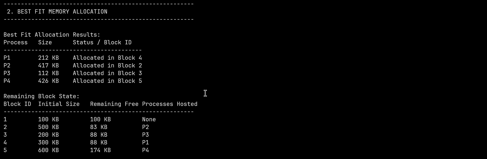
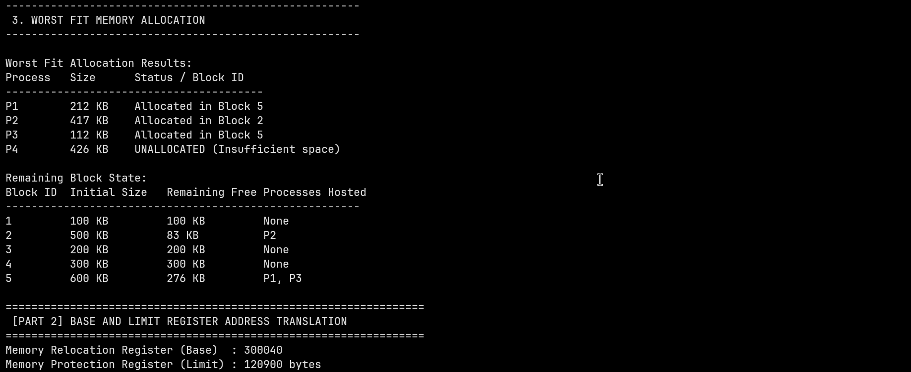
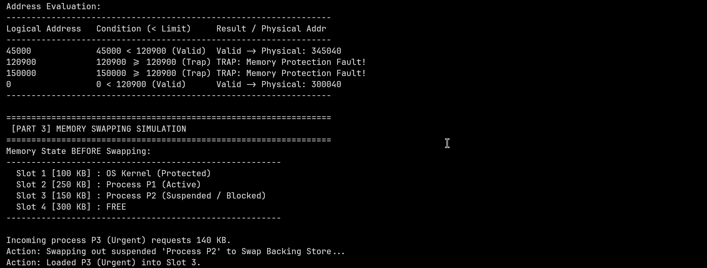
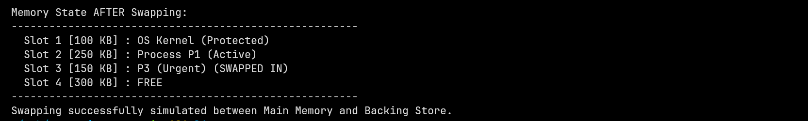

# Q1: Contiguous Allocation, Swapping and Address Translation

**Student Name:** Varun Chauhan  
**Roll Number:** 2401010276  
**Course:** B.Tech CSE Sec B  
**Section:** 3 (Memory, Virtual Memory, Device Management and Disk Scheduling)  

---

## 1. Problem Statement & Objectives
1. **Contiguous Allocation Algorithms**:
   - Accept memory blocks and processes (in KB).
   - Implement **First Fit** (allocates first sufficient block).
   - Implement **Best Fit** (allocates smallest sufficient block, minimizing remaining fragment).
   - Implement **Worst Fit** (allocates largest available block).
   - Use clean/fresh memory block states for each algorithm.
   - Report allocated/unallocated processes and remaining block sizes.
2. **Address Translation**:
   - Accept Base, Limit, and Logical Address values.
   - Validate logical address against limit ($0 \le \text{Logical} < \text{Limit}$).
   - Compute physical address: $\text{Physical} = \text{Base} + \text{Logical}$, or trap invalid address faults.
3. **Swapping Simulation**:
   - Simulate releasing an outgoing blocked process to secondary swap storage.
   - Load incoming high-priority process into freed memory slot.
   - Display memory state before and after swapping.

---

## 2. Theoretical Concepts
- **Internal vs External Fragmentation**:
  - *External Fragmentation*: Total free memory is sufficient to satisfy a request, but the space is not contiguous.
  - *Internal Fragmentation*: Memory allocated to a process is slightly larger than requested; unused space within the partition.
- **Relocation Register (Base)**: Loaded into CPU MMU, added to every logical address generated by the user process.
- **Limit Register**: Protects user address space; addresses $\ge \text{Limit}$ generate an addressing error trap to the OS kernel.

---

## 3. How to Run the Script

```bash
python3 contiguous_swapping.py
```

---

## 4. Output Screenshots










