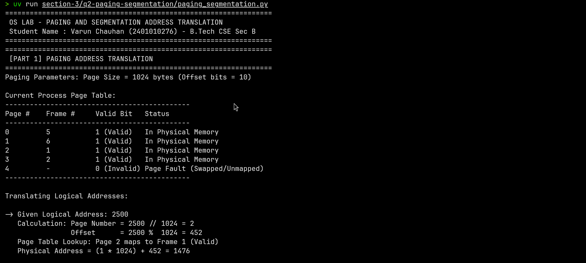
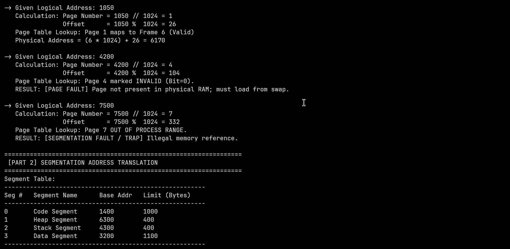
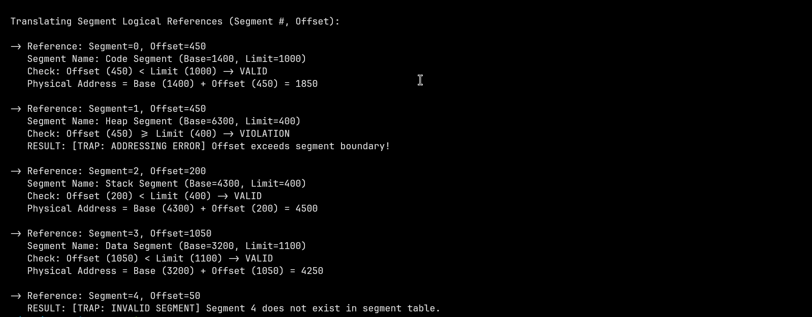

# Q2: Paging and Segmentation

**Student Name:** Varun Chauhan  
**Roll Number:** 2401010276  
**Course:** B.Tech CSE Sec B  
**Section:** 3 (Memory, Virtual Memory, Device Management and Disk Scheduling)  

---

## 1. Problem Statement & Objectives
1. **Paging Address Translation**:
   - Accept page size (e.g., $1024$ bytes) and page table with frame numbers and valid/invalid bits.
   - For a given logical address:
     $$\text{Page Number} = \lfloor \text{Logical Address} / \text{Page Size} \rfloor$$
     $$\text{Offset} = \text{Logical Address} \pmod{\text{Page Size}}$$
   - Verify page table entry validity; reject unmapped or invalid pages (Page Fault / Trap).
   - Calculate physical address:
     $$\text{Physical Address} = (\text{Frame Number} \times \text{Page Size}) + \text{Offset}$$
2. **Segmentation Address Translation**:
   - Accept segment table with segment base and limit values.
   - For a given logical tuple $(\text{Segment \#}, \text{Offset})$:
     - Validate: Check if $\text{Offset} < \text{Limit}$.
     - If valid: $\text{Physical Address} = \text{Base} + \text{Offset}$.
     - If invalid: Trap for memory protection violation.
   - Display all intermediate calculations and decisions.

---

## 2. Theoretical Concepts
- **Paging**: Non-contiguous memory allocation technique dividing physical memory into fixed-sized blocks called **frames** and logical memory into blocks called **pages**. Eliminates external fragmentation.
- **Segmentation**: Memory-management scheme supporting the programmer's view of memory. A program is a collection of logical variable-length units (Code, Stack, Heap, Data). Subject to external fragmentation.

---

## 3. How to Run the Script

```bash
python3 paging_segmentation.py
```

---

## 4. Output Screenshots






