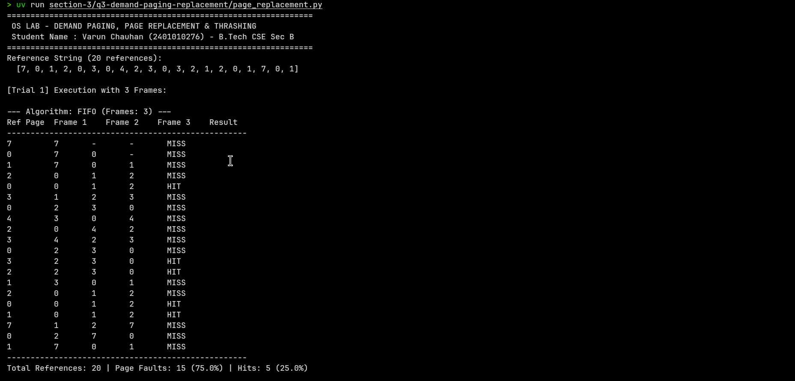
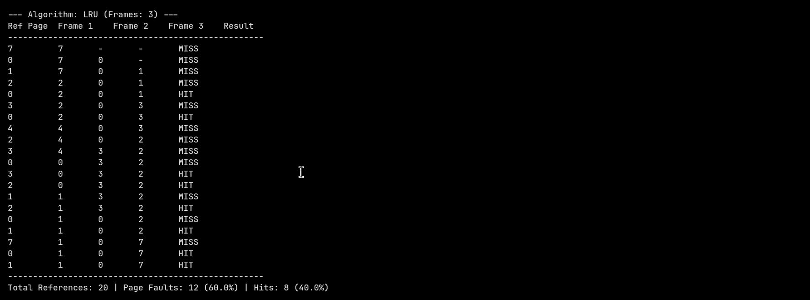
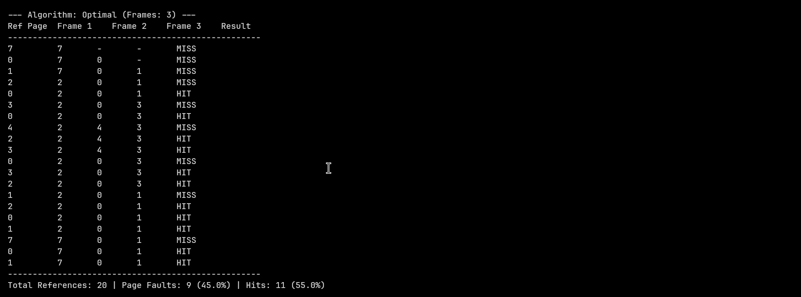
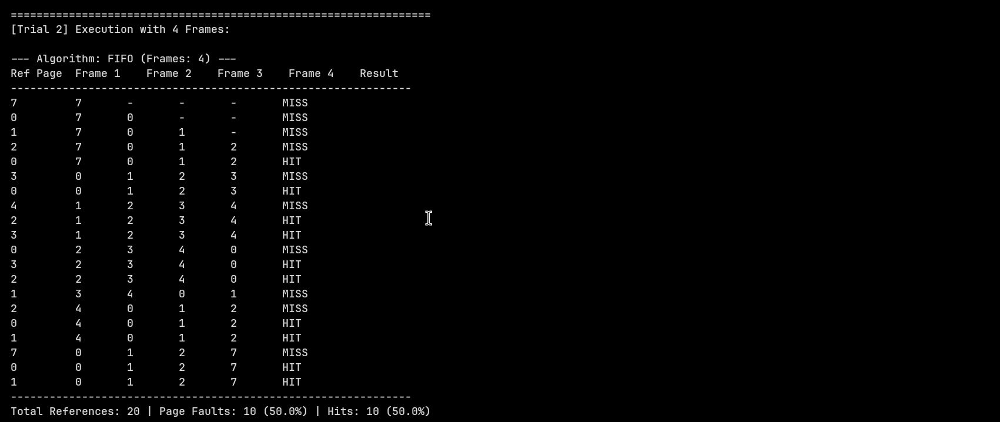
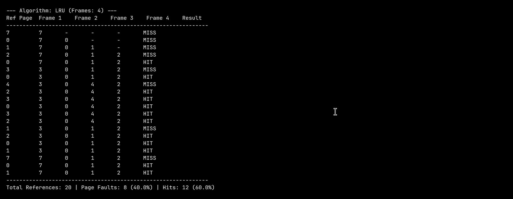
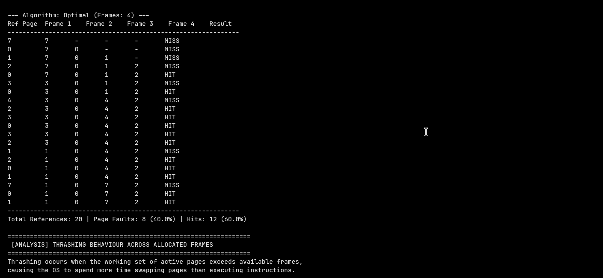
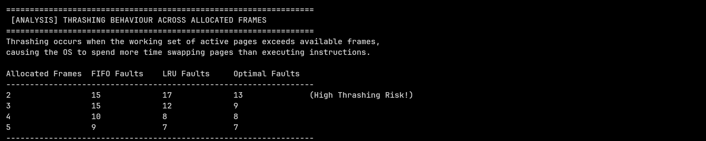

# Q3: Demand Paging, Page Replacement and Thrashing

**Student Name:** Varun Chauhan  
**Roll Number:** 2401010276  
**Course:** B.Tech CSE Sec B  
**Section:** 3 (Memory, Virtual Memory, Device Management and Disk Scheduling)  

---

## 1. Problem Statement & Objectives
1. **Reference String**: Use identical reference stream: `[7, 0, 1, 2, 0, 3, 0, 4, 2, 3, 0, 3, 2, 1, 2, 0, 1, 7, 0, 1]`.
2. **Page Replacement Algorithms**:
   - **FIFO (First-In, First-Out)**: Evict oldest loaded page.
   - **LRU (Least Recently Used)**: Evict page that has not been used for the longest period of time.
   - **Optimal (Belady's Algorithm)**: Evict page that will not be used for the longest period in the future.
3. **Step-by-Step Tracing**:
   - Classify each access as **HIT** or **PAGE FAULT (MISS)**.
   - Fill free frames before replacement.
   - Print full frame buffer state after every access.
4. **Metrics**:
   - Calculate total hits, page faults, fault ratio ($Faults / Total$), and hit ratio ($Hits / Total$).
5. **Frame Allocation & Thrashing**:
   - Evaluate across multiple frame counts ($F = 2, 3, 4, 5$).
   - Identify high fault rate scenarios demonstrating **Thrashing**.

---

## 2. Theoretical Concepts & Comparisons
- **FIFO**: Simple to implement using a queue. Vulnerable to **Belady's Anomaly** (increasing frame count can sometimes increase page faults).
- **LRU**: Approximates the optimal algorithm by using past behaviour to predict the future. Does not suffer from Belady's Anomaly.
- **Optimal (OPT)**: Has the lowest possible page-fault rate for any given reference string. Serves as an unrealizable theoretical benchmark.
- **Thrashing**: Occurs when processes spend excessive time paging in/out instead of computing, caused by insufficient frame allocation.

---

## 3. How to Run the Script

```bash
python3 page_replacement.py
```

---

## 4. Output Screenshots














