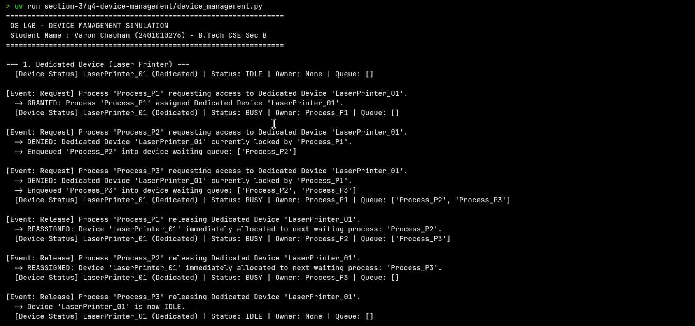
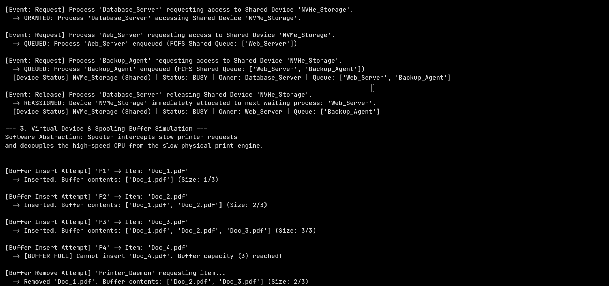
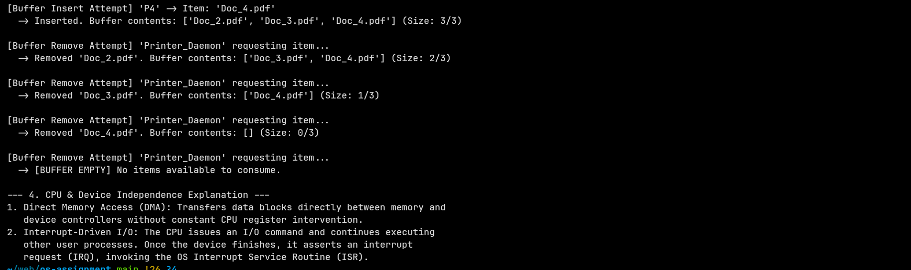

# Q4: Device Management Simulation

**Student Name:** Varun Chauhan  
**Roll Number:** 2401010276  
**Course:** B.Tech CSE Sec B  
**Section:** 3 (Memory, Virtual Memory, Device Management and Disk Scheduling)  

---

## 1. Problem Statement & Objectives
1. **Device Record Structures**:
   - Maintain device name, device type (Dedicated, Shared, Virtual), status (`IDLE` / `BUSY`), current owner, and waiting queue.
2. **Dedicated Device Allocation**:
   - Allocate exclusive devices (e.g., dedicated hardware printer). Reject new concurrent requests and place requesting processes into a waiting queue.
3. **Shared Device Queuing**:
   - Simulate shared device access (e.g., storage disk) using an FCFS service queue policy.
4. **Virtual Device & Spooling Abstraction**:
   - Implement a software-abstracted virtual device backed by a finite buffer.
   - Trace buffer states: **Insertion**, **Removal**, **FULL**, and **EMPTY**.
5. **Device Release & Reassignment**:
   - Release device upon request completion and automatically allocate it to the next waiting process.
6. **Independence of CPU and I/O**:
   - Explain how Interrupts and Direct Memory Access (DMA) allow the CPU and I/O devices to operate concurrently and independently.

---

## 2. Theoretical Concepts
- **Dedicated Devices**: Assigned to only one process at a time until released (printers, plotters).
- **Shared Devices**: Multiple processes can interleave access (hard drives, solid state disks).
- **Virtual Devices (SPOOLing)**: *Simultaneous Peripheral Operations On-Line*. Disks act as large buffers, holding print jobs until slow output devices can accept them.
- **DMA (Direct Memory Access)**: Transfers entire blocks of data between peripheral devices and main memory without continuous CPU involvement.

---

## 3. How to Run the Script

```bash
python3 device_management.py
```

---

## 4. Output Screenshots






