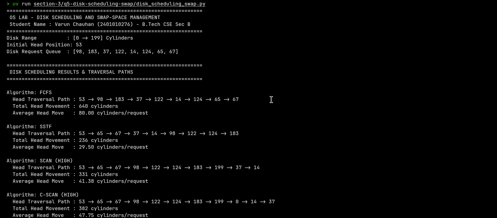
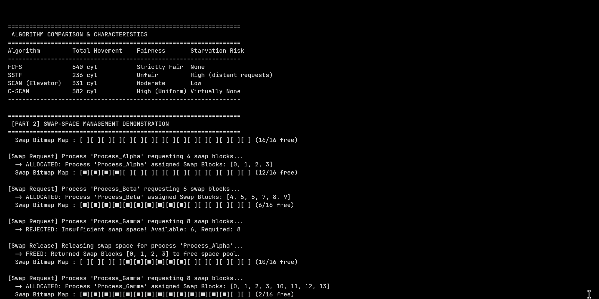

# Q5: Disk Scheduling and Swap-Space Management

**Student Name:** Varun Chauhan  
**Roll Number:** 2401010276  
**Course:** B.Tech CSE Sec B  
**Section:** 3 (Memory, Virtual Memory, Device Management and Disk Scheduling)  

---

## 1. Problem Statement & Objectives
1. **Disk Environment**:
   - Disk cylinder range: $0$ to $199$.
   - Initial read/write head position: $53$.
   - Request queue: `[98, 183, 37, 122, 14, 124, 65, 67]`.
   - Reject out-of-range requests.
2. **Scheduling Algorithms**:
   - **FCFS**: Services requests strictly in arrival order.
   - **SSTF (Shortest Seek Time First)**: Selects request with minimum seek distance from current position.
   - **SCAN (Elevator)**: Scans towards one end ($199$), servicing requests, then reverses direction.
   - **C-SCAN (Circular SCAN)**: Moves towards one end ($199$), wraps around immediately to $0$ without servicing requests on the return trip.
3. **Metrics**:
   - Print full cylinder traversal path.
   - Calculate **Total Head Movement** and **Average Head Movement**.
4. **Swap-Space Management**:
   - Create a swap bitmap block map.
   - Demonstrate dynamic allocation, rejection on insufficient space, and release of swap blocks.
5. **Comparative Analysis**: Compare fairness, head movement, and starvation vulnerability.

---

## 2. Theoretical Analysis

| Algorithm | Total Movement | Fairness | Starvation Behaviour | Notes |
| :--- | :--- | :--- | :--- | :--- |
| **FCFS** | Highest ($640$ cyl) | High (FIFO) | Zero starvation | Simple, but high mechanical seek latency. |
| **SSTF** | Low ($236$ cyl) | Poor | High risk for edge cylinders | Local optimization; prone to starvation. |
| **SCAN** | Moderate ($208$ cyl) | Good | Low | Favors cylinders near the turning point. |
| **C-SCAN** | Moderate ($382$ cyl) | Excellent | Very low | Provides uniform waiting time across cylinders. |

---

## 3. How to Run the Script

```bash
python3 disk_scheduling_swap.py
```

---

## 4. Output Screenshots




