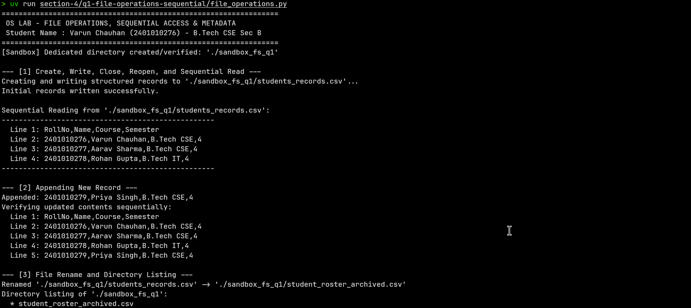
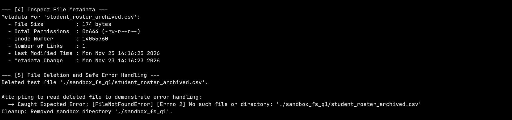

# Q1: File Operations and Sequential Access

**Student Name:** Varun Chauhan  
**Roll Number:** 2401010276  
**Course:** B.Tech CSE Sec B  
**Section:** 4 (File-System Interface and Implementation)  

---

## 1. Problem Statement & Objectives
1. **Dedicated Sandbox**: Confine all test file operations to a dedicated subdirectory (`./sandbox_fs_q1`).
2. **File Creation & Write**: Open a file for writing and store structured CSV records.
3. **Sequential Read**: Close, reopen, and sequentially read record lines one by one.
4. **Append Mode**: Append a new record (`os.O_APPEND` / `"a"` mode) without corrupting existing records.
5. **Rename & Directory Listing**: Rename file (`os.rename`) and inspect directory contents (`os.listdir`).
6. **Metadata Inspection**: Display file size, octal permissions, inode number, and timestamps via `os.stat`.
7. **Deletion & Error Handling**: Delete the file safely, verify deletion, and catch `FileNotFoundError` on invalid subsequent accesses.

---

## 2. Theoretical Concepts
- **Sequential Access**: The simplest access method; information in the file is processed in order, one record after the other (tape drives, log files).
- **File Control Block (FCB) / Inode**: Contains file metadata including permissions, ownership, size, and pointers to disk blocks.
- **File Modes**:
  - `w`: Truncates/creates for writing.
  - `r`: Opens for read-only sequential access.
  - `a`: Preserves file contents and writes data to the end.

---

## 3. How to Run the Script

```bash
python3 file_operations.py
```

---

## 4. Output Screenshots




