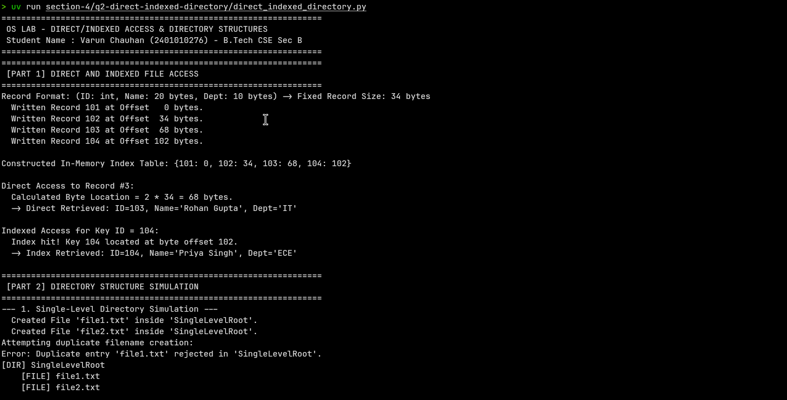
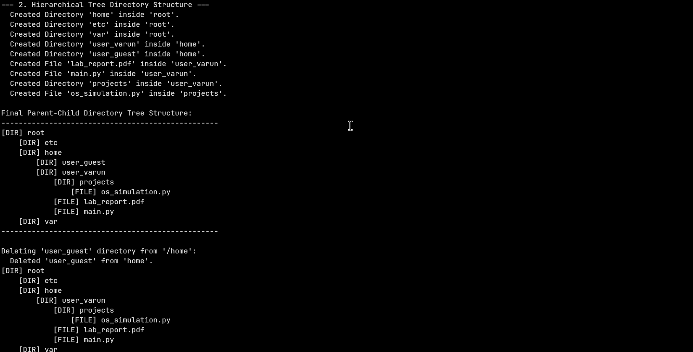

# Q2: Direct, Indexed Access and Directory Structures

**Student Name:** Varun Chauhan  
**Roll Number:** 2401010276  
**Course:** B.Tech CSE Sec B  
**Section:** 4 (File-System Interface and Implementation)  

---

## 1. Problem Statement & Objectives
1. **Direct Access**:
   - Create a fixed-size binary record file.
   - Jump directly to target record via `seek(record_index * record_size)`.
2. **Indexed Access**:
   - Construct an in-memory index structure associating primary keys with exact byte positions.
   - Search the index before reading the target record from disk.
3. **Directory Structures**:
   - Simulate a **Single-Level Directory** (demonstrate rejection of duplicate file names).
   - Simulate a **Two-Level / Hierarchical Tree Directory Structure**.
   - Implement operations: `create`, `search`, `list`, and `delete`.
   - Render the complete parent-child directory hierarchy.

---

## 2. Theoretical Concepts
- **Direct Access (Relative Access)**: Treats the file as a numbered sequence of blocks or records. Read and write operations can occur in any arbitrary order.
- **Indexed Access**: An index is created containing pointers to various blocks. To find a record, the index is searched first, and the resulting pointer directly locates the record.
- **Directory Systems**:
  - *Single-Level*: All files in one directory; collision-prone with multiple users.
  - *Two-Level*: Separate directory for each user.
  - *Tree-Structured*: Flexible hierarchical model supporting directories within directories.

---

## 3. How to Run the Script

```bash
python3 direct_indexed_directory.py
```

---

## 4. Output Screenshots




