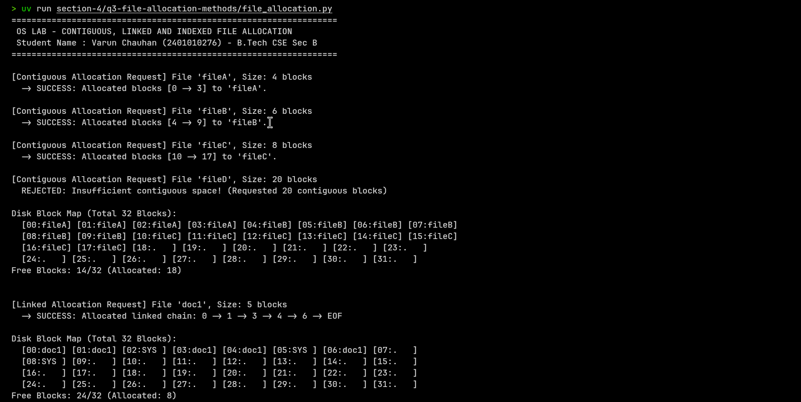
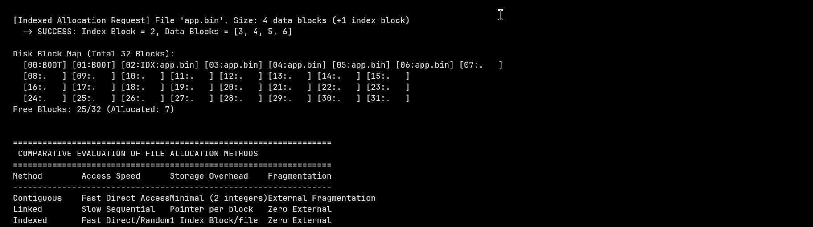

# Q3: Contiguous, Linked and Indexed Allocation

**Student Name:** Varun Chauhan  
**Roll Number:** 2401010276  
**Course:** B.Tech CSE Sec B  
**Section:** 4 (File-System Interface and Implementation)  

---

## 1. Problem Statement & Objectives
1. **Simulated Disk**: Model a storage disk divided into numbered logical blocks ($0$ to $31$).
2. **Contiguous Allocation**:
   - Allocate contiguous sequences of free disk blocks.
   - Record directory metadata: $\text{Start Block}$ and $\text{Length}$.
   - Reject requests when contiguous span is unavailable.
3. **Linked Allocation**:
   - Allocate scattered free blocks chained by pointers.
   - Record directory metadata: $\text{Start Block}$ and $\text{End Block}$, with each block pointing to the next ($\to \text{EOF}$).
4. **Indexed Allocation**:
   - Allocate an Index Block storing an array of pointers to data blocks.
   - Record directory metadata: $\text{Index Block Address}$.
5. **Disk Visualizations & Comparative Analysis**:
   - Display a visual disk block map.
   - Compare access speed, storage overhead, and external/internal fragmentation.

---

## 2. Theoretical Comparison

| Allocation Method | Direct Access Speed | Storage Overhead | Fragmentation |
| :--- | :--- | :--- | :--- |
| **Contiguous** | Excellent ($O(1)$) | Minimal (Start + Length) | High External Fragmentation |
| **Linked** | Poor ($O(N)$ sequential traversal) | Pointer per block ($4$ bytes) | Zero External Fragmentation |
| **Indexed** | Excellent ($O(1)$ direct lookup) | Dedicated Index Block | Zero External Fragmentation |

---

## 3. How to Run the Script

```bash
python3 file_allocation.py
```

---

## 4. Output Screenshots




