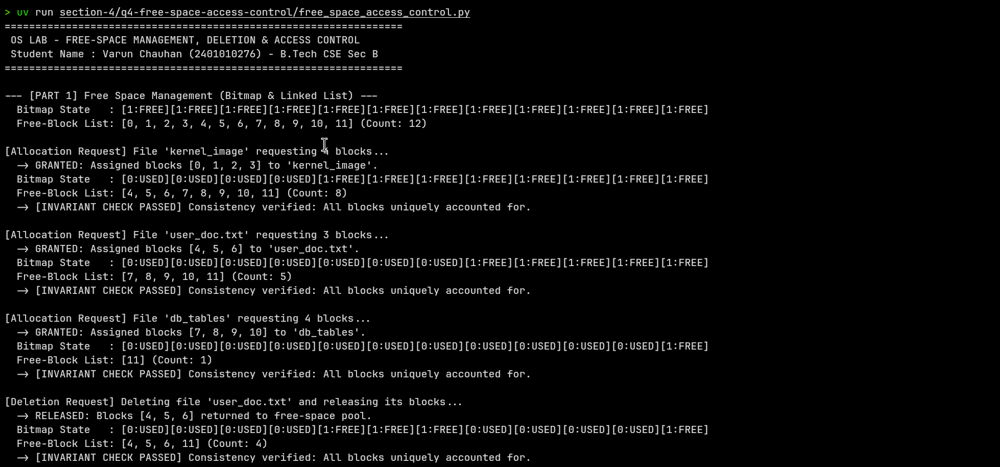
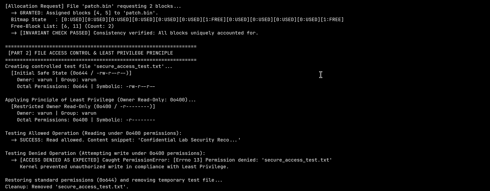

# Q4: Free-Space Management, Deletion and Access Control

**Student Name:** Varun Chauhan  
**Roll Number:** 2401010276  
**Course:** B.Tech CSE Sec B  
**Section:** 4 (File-System Interface and Implementation)  

---

## 1. Problem Statement & Objectives
1. **Free-Space Management**:
   - Represent disk space using a **Bitmap** ($1 = \text{Free}, 0 = \text{Allocated}$).
   - Construct and maintain a **Free-Block List**.
   - Dynamically update free space upon file allocation.
2. **File Deletion & Block Reclamation**:
   - Release all allocated blocks back to the free pool upon file deletion.
   - Enforce an **Invariant Check**: Formally verify that no block is ever marked as simultaneously allocated and free.
3. **POSIX Access Control & Least Privilege**:
   - Inspect ownership (UID/GID), octal permissions, and symbolic modes.
   - Apply secure permissions (`0o644`, `0o400`, `0o600`) without using insecure defaults like `chmod 777`.
   - Test authorized reads vs denied writes (`PermissionError`).
   - Clean up temporary files.

---

## 2. Theoretical Concepts & Security Principles
- **Bitmap (Bit Vector)**: A compact array of bits where bit $i = 1$ indicates block $i$ is free, and bit $i = 0$ indicates block $i$ is allocated. High performance on modern CPUs with built-in bit-scan instructions.
- **Principle of Least Privilege**: A process or user should be granted only the minimum permissions necessary to accomplish its intended function.
- **Insecurity of `chmod 777`**: Grants Read, Write, and Execute rights to everyone (Owner, Group, Others), violating least privilege and exposing system resources to tampering.

---

## 3. How to Run the Script

```bash
python3 free_space_access_control.py
```

---

## 4. Output Screenshots




